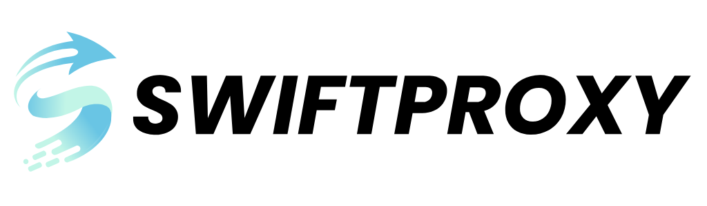
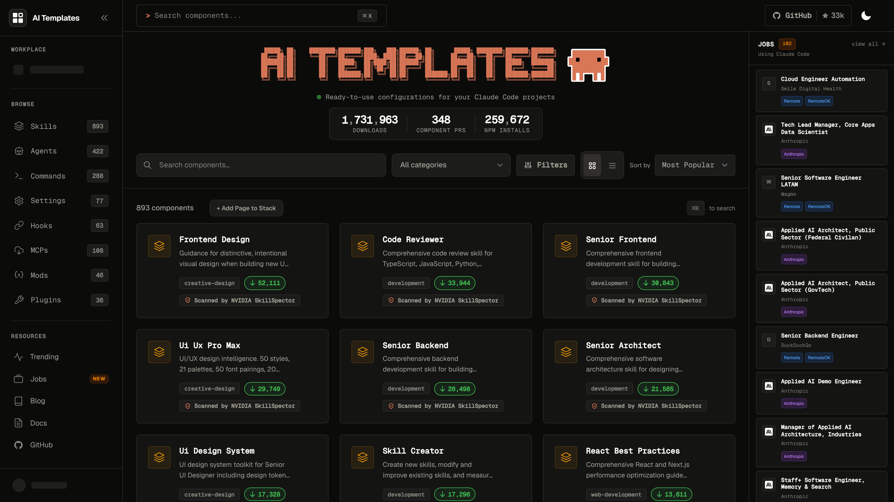
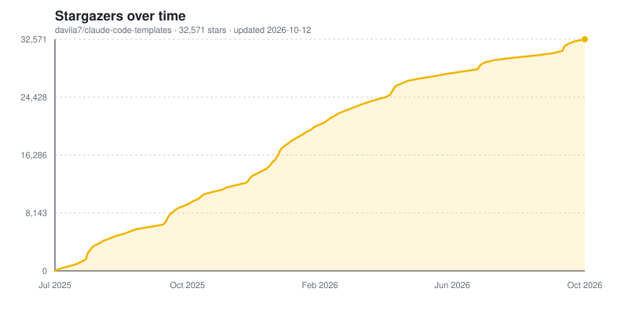

[](https://www.npmjs.com/package/claude-code-templates)
[](https://www.npmjs.com/package/claude-code-templates)
[](https://opensource.org/licenses/MIT)
[](CONTRIBUTING.md)
[](https://z.ai/subscribe?ic=8JVLJQFSKB&utm_source=github&utm_medium=badge&utm_campaign=readme)
[](https://claude.com/contact-sales/claude-for-oss)
[](https://get.neon.com/4eCjZDz)
[](https://github.com/sponsors/davila7)
[](https://buymeacoffee.com/daniavila)
[](https://github.com/davila7/claude-code-templates)

<p align="center">
  <a href="https://trendshift.io/repositories/15113" target="_blank">
    
  </a>
  <br />
  <br />
  <a href="https://vercel.com/oss">
  
  </a>
  &nbsp;&nbsp;
  <a href="https://get.neon.com/4eCjZDz">
  
  </a>
  &nbsp;&nbsp;
  <a href="https://claude.com/contact-sales/claude-for-oss">
  
  </a>
</p>

---

<p align="center">
  <a href="https://www.swiftproxy.net/" target="_blank">
    <picture>
      <source media="(prefers-color-scheme: dark)" srcset="docs/sponsors/swiftproxy-dark.png" />
      <source media="(prefers-color-scheme: light)" srcset="docs/sponsors/swiftproxy-light.png" />
      
    </picture>
  </a>
</p>

<h3 align="center">Sponsored by <a href="https://www.swiftproxy.net/">Swiftproxy</a></h3>

<p align="center">
  <b>Swiftproxy proudly supports this project.</b><br />
  Connect your AI-powered workflows to reliable residential proxies for web data collection, browser automation, and AI-driven research.<br />
  90M+ residential IPs across 220+ locations, rotating and static residential proxies, with HTTP(S) and SOCKS5 support.
</p>

<p align="center">
  <a href="https://www.swiftproxy.net/">
    
  </a>
</p>

---

# Claude Code Templates ([aitmpl.com](https://aitmpl.com))

**Ready-to-use configurations for Anthropic's Claude Code.** An open catalog of about 1,900 components (skills, agents, slash commands, MCP integrations, settings, hooks, mods, loops, sandboxes and project templates), installable with one command.

## Browse & Install Components and Templates

**[Browse all components](https://aitmpl.com)**: search the catalog, preview every file a component writes, and combine several components into a single install command.

<picture>
  <source media="(prefers-color-scheme: dark)" srcset="docs/images/readme/aitmpl-catalog-dark.png" />
  <source media="(prefers-color-scheme: light)" srcset="docs/images/readme/aitmpl-catalog-light.png" />
  
</picture>


## 🚀 Quick Installation

```bash
# Install a complete development stack
npx claude-code-templates@latest --agent development-team/frontend-developer --command testing/generate-tests --mcp integration/github-integration --yes

# Browse and install interactively
npx claude-code-templates@latest

# Install specific components
npx claude-code-templates@latest --skill creative-design/frontend-design --yes
npx claude-code-templates@latest --agent development-tools/code-reviewer --yes
npx claude-code-templates@latest --command performance/optimize-bundle-size --yes
npx claude-code-templates@latest --setting mcp/mcp-timeouts --yes
npx claude-code-templates@latest --hook git/conventional-commits --yes
npx claude-code-templates@latest --mcp database/postgresql-integration --yes
npx claude-code-templates@latest --mod security/secret-redactor --yes
npx claude-code-templates@latest --loop engineering/docs-sweep-loop --yes  # also installs the components the loop uses
```

## What You Get

| Component | Description | Examples |
|-----------|-------------|----------|
| **🎨 Skills** (890+) | Reusable capabilities with progressive disclosure | PDF processing, frontend design, code review |
| **🤖 Agents** (420+) | AI specialists for specific domains | Security auditor, frontend developer, database architect |
| **⚡ Commands** (280+) | Custom slash commands | `/generate-tests`, `/optimize-bundle-size`, `/security-audit` |
| **🔌 MCPs** (100+) | External service integrations | GitHub, PostgreSQL, Stripe, Supabase, Sentry |
| **⚙️ Settings** (75+) | Claude Code configurations | Timeouts, permissions, status lines |
| **🪝 Hooks** (60+) | Automation triggers | Conventional commits, blocking direct pushes |
| **🧩 Mods** (45+) | Plugins that change Claude Code's own interface and behavior (Claude Code 2.1.287+) | Secret redaction, protected paths, terminal games |
| **🔁 Loops** (18) | Autonomous workflows with a goal, an interval and a stop condition | Docs sweep, build-test-fix, adversarial review |
| **📦 Sandboxes** (11) | Run Claude Code in an isolated environment | E2B, Cloudflare, Docker |
| **🗂️ Templates** (14) | Complete project configurations | Language and framework setups |

Current counts are in [`dashboard/public/counts.json`](dashboard/public/counts.json).

## 🛠️ Additional Tools

Beyond the template catalog, Claude Code Templates includes powerful development tools:

### 📊 Claude Code Analytics
Monitor your AI-powered development sessions in real-time with live state detection and performance metrics.

```bash
npx claude-code-templates@latest --analytics
```

### 💬 Conversation Monitor
Mobile-optimized interface to view Claude responses in real time, with optional remote access through a Cloudflare Tunnel.

```bash
# Local access
npx claude-code-templates@latest --chats

# Remote access via Cloudflare Tunnel
npx claude-code-templates@latest --chats --tunnel
```

### 🔍 Health Check
Comprehensive diagnostics to ensure your Claude Code installation is optimized.

```bash
npx claude-code-templates@latest --health-check
```

### 🔌 Plugin Dashboard
View marketplaces, installed plugins, and manage permissions from a unified interface.

```bash
npx claude-code-templates@latest --plugins
```

## 📖 Documentation

**[📚 docs.aitmpl.com](https://docs.aitmpl.com/)** - Complete guides, examples, and API reference for all components and tools.

## Contributing

We welcome contributions! **[Browse existing templates](https://aitmpl.com)** to see what's available, then check our [contributing guidelines](CONTRIBUTING.md) to add your own skills, agents, commands, MCPs, settings, hooks or mods. Every pull request is checked by Claude Code's plugin validator and scanned by [NVIDIA SkillSpector](https://github.com/NVIDIA/skillspector).

**Please read our [Code of Conduct](CODE_OF_CONDUCT.md) before contributing.**

## Attribution

This collection includes components from multiple sources:

**Scientific Skills:**
- **[K-Dense-AI/claude-scientific-skills](https://github.com/K-Dense-AI/claude-scientific-skills)** by K-Dense Inc. - MIT License (139 scientific skills for biology, chemistry, medicine, and computational research)

**Official Anthropic:**
- **[anthropics/skills](https://github.com/anthropics/skills)** - Official Anthropic skills (21 skills)
- **[anthropics/claude-code](https://github.com/anthropics/claude-code)** - Development guides and examples (10 skills)

**Community Skills & Agents:**
- **[obra/superpowers](https://github.com/obra/superpowers)** by Jesse Obra - MIT License (14 workflow skills)
- **[alirezarezvani/claude-skills](https://github.com/alirezarezvani/claude-skills)** by Alireza Rezvani - MIT License (36 professional role skills)
- **[wshobson/agents](https://github.com/wshobson/agents)** by wshobson - MIT License (48 agents)
- **NerdyChefsAI Skills** - Community contribution - MIT License (specialized enterprise skills)

**Commands & Tools:**
- **[awesome-claude-code](https://github.com/hesreallyhim/awesome-claude-code)** by hesreallyhim - CC0 1.0 Universal (21 commands)
- **[awesome-claude-skills](https://github.com/mehdi-lamrani/awesome-claude-skills)** - Apache 2.0 (community skills)
- **move-code-quality-skill** - MIT License
- **cocoindex-claude** - Apache 2.0

Each of these resources retains its **original license and attribution**, as defined by their respective authors.
We respect and credit all original creators for their work and contributions to the Claude ecosystem.

## 📄 License

This project is licensed under the MIT License - see the [LICENSE](LICENSE) file for details.

## 🔗 Links

- **🌐 Browse Templates**: [aitmpl.com](https://aitmpl.com)
- **📚 Documentation**: [docs.aitmpl.com](https://docs.aitmpl.com)
- **💬 Community**: [GitHub Discussions](https://github.com/davila7/claude-code-templates/discussions)
- **🐛 Issues**: [GitHub Issues](https://github.com/davila7/claude-code-templates/issues)

## Stargazers over time
[](https://www.aitmpl.com/component/skill/git/star-history-chart)

---

**⭐ Found this useful? Give us a star to support the project!**

[](https://github.com/sponsors/davila7)

[](https://buymeacoffee.com/daniavila)
