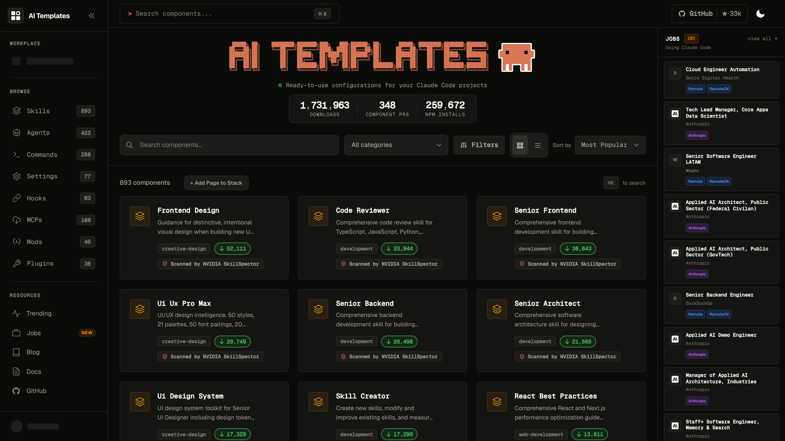
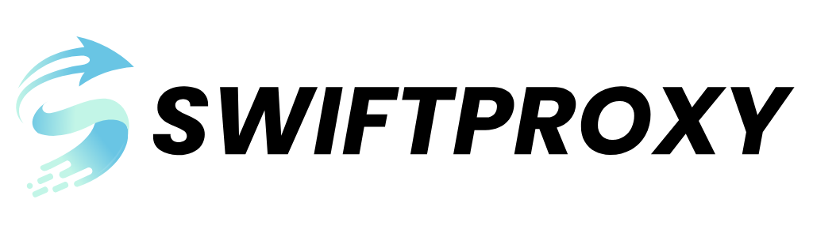
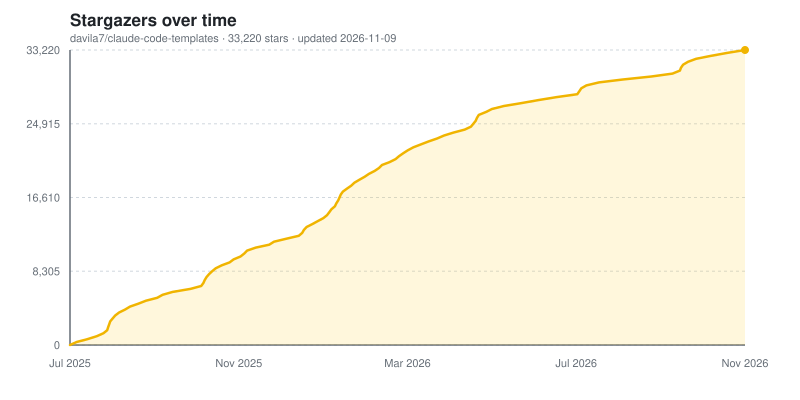

<p align="center">
  <a href="https://www.aitmpl.com">
    <picture>
      <source media="(prefers-color-scheme: dark)" srcset="docs/images/readme/logo-dark.svg" />
      <source media="(prefers-color-scheme: light)" srcset="docs/images/readme/logo-light.svg" />
      
    </picture>
  </a>
</p>

<h1 align="center">Claude Code Templates</h1>

<p align="center">
  An open catalog of components for Claude Code, installable with one command.
</p>

<p align="center">
  <a href="https://www.npmjs.com/package/claude-code-templates"></a>
  <a href="https://www.npmjs.com/package/claude-code-templates"></a>
  <a href="https://github.com/davila7/claude-code-templates/stargazers"></a>
  <a href="LICENSE"></a>
</p>

<p align="center">
  <a href="https://www.aitmpl.com"><b>Browse the catalog</b></a>
  &nbsp;·&nbsp;
  <a href="https://docs.aitmpl.com">Documentation</a>
  &nbsp;·&nbsp;
  <a href="CONTRIBUTING.md">Contributing</a>
  &nbsp;·&nbsp;
  <a href="https://github.com/davila7/claude-code-templates/discussions">Discussions</a>
  &nbsp;·&nbsp;
  <a href="CHANGELOG.md">Changelog</a>
</p>

<p align="center">
  <sub>Sponsored by <a href="https://www.swiftproxy.net/"><b>Swiftproxy</b></a> and <a href="https://z.ai/subscribe?ic=8JVLJQFSKB&utm_source=github&utm_medium=badge&utm_campaign=readme"><b>Z.AI</b></a> · <a href="#sponsors-and-programs">all sponsors and programs</a></sub>
</p>

<picture>
  <source media="(prefers-color-scheme: dark)" srcset="docs/images/readme/aitmpl-catalog-dark.png" />
  <source media="(prefers-color-scheme: light)" srcset="docs/images/readme/aitmpl-catalog-light.png" />
  
</picture>

## About

Claude Code is configured through small files: skills, subagents, slash commands, hooks, MCP servers and settings. Claude Code Templates collects more than 1,980 of them in one catalog at [aitmpl.com](https://www.aitmpl.com), where you can search, preview every file a component writes, and combine several components into a single install command. The CLI writes each file to the right place and merges existing configuration instead of overwriting it.

Every pull request is checked by Claude Code's plugin validator and scanned by [NVIDIA SkillSpector](https://github.com/NVIDIA/skillspector).

## Quickstart

Runs with `npx`, no global install needed.

```bash
# Browse the catalog and install interactively
npx claude-code-templates@latest

# Install one component
npx claude-code-templates@latest --skill creative-design/frontend-design

# Install a stack in one command
npx claude-code-templates@latest \
  --agent development-team/frontend-developer \
  --command testing/generate-tests \
  --mcp integration/github-integration
```

Add `--yes` to skip the confirmation prompt. Every component page on [aitmpl.com](https://www.aitmpl.com) shows its exact install command.

<details>
<summary>One example per component type</summary>

```bash
npx claude-code-templates@latest --skill creative-design/frontend-design
npx claude-code-templates@latest --agent development-tools/code-reviewer
npx claude-code-templates@latest --command performance/optimize-bundle-size
npx claude-code-templates@latest --mcp database/postgresql-integration
npx claude-code-templates@latest --setting mcp/mcp-timeouts
npx claude-code-templates@latest --hook git/conventional-commits
npx claude-code-templates@latest --mod security/secret-redactor      # Claude Code 2.1.287+
npx claude-code-templates@latest --loop engineering/docs-sweep-loop  # also installs the components the loop uses
npx claude-code-templates@latest --plugin productivity/champion-kit  # via the aitmpl marketplace, Claude Code 2.1.288+
```

</details>

## What's in the catalog

| Type | Count | What it is | Examples |
|------|------:|------------|----------|
| **Skills** | 918 | Reusable capabilities with progressive disclosure | PDF processing, frontend design, code review |
| **Agents** | 422 | Subagents specialized in one domain | Security auditor, frontend developer, database architect |
| **Commands** | 288 | Custom slash commands | `/generate-tests`, `/optimize-bundle-size`, `/security-audit` |
| **MCPs** | 119 | External service integrations | GitHub, PostgreSQL, Stripe, Supabase, Sentry |
| **Settings** | 80 | Claude Code configuration | Timeouts, permissions, status lines |
| **Hooks** | 63 | Automation triggers | Conventional commits, blocking direct pushes |
| **Mods** | 50 | Plugins that change Claude Code's own interface and behavior | Secret redaction, protected paths, terminal games |
| **Loops** | 18 | Autonomous workflows with a goal, an interval and a stop condition | Docs sweep, build-test-fix, adversarial review |
| **Templates** | 14 | Complete project configurations | Language and framework setups |
| **Sandboxes** | 11 | Launchers that run Claude Code in an isolated environment (reference only, see [`cli-tool/components/sandbox/`](cli-tool/components/sandbox/)) | E2B, Cloudflare, Docker |
| **Plugins** | 1 | Whole Claude Code plugins, installed from the `aitmpl` marketplace | Champion Kit |

Live counts: [`dashboard/public/counts.json`](dashboard/public/counts.json).

## Local tools

The CLI also ships three local tools. The two dashboards listen on `127.0.0.1` only, because they serve your conversation history.

| Command | What it does |
|---------|--------------|
| `npx claude-code-templates@latest --analytics` | Real-time session monitoring and usage metrics at `localhost:3333` |
| `npx claude-code-templates@latest --chats` | Read and search your conversations in a mobile-friendly UI at `localhost:9876` |
| `npx claude-code-templates@latest --health-check` | Diagnose your Claude Code installation and project setup |

To open the conversation browser from another device, forward the port over SSH: `ssh -L 9876:localhost:9876 <host>`.

<details>
<summary>Flags removed in 1.31.0</summary>

`--plugins`, `--skills-manager`, `--command-stats`, `--hook-stats`, `--mcp-stats`, `--agents`, `--chats-mobile`, `--teams`, `--2025`, `--studio`, `--sandbox`, `--tunnel`, `--create-agent`, `--list-agents`, `--update-agent`, `--remove-agent` and `--clone-session` were removed. Running one prints what replaced it. To see what is installed in each scope, use the [stack viewer mod](https://www.aitmpl.com/component/mods/ui/stack-viewer) (`--mod ui/stack-viewer`, then `/stack` in Claude Code). Details in the [CHANGELOG](CHANGELOG.md).

</details>

## Documentation

Guides, the CLI reference and the catalog API live at **[docs.aitmpl.com](https://docs.aitmpl.com)**.

## Contributing

Contributions are welcome. Read the [contributing guide](CONTRIBUTING.md) to add a skill, agent, command, MCP, setting, hook or mod, and the [Code of Conduct](CODE_OF_CONDUCT.md) before you open a pull request.

## Sponsors and programs

### Sponsors

<p align="center">
  <a href="https://www.swiftproxy.net/">
    <picture>
      <source media="(prefers-color-scheme: dark)" srcset="docs/sponsors/swiftproxy-dark.png" />
      <source media="(prefers-color-scheme: light)" srcset="docs/sponsors/swiftproxy-light.png" />
      
    </picture>
  </a>
</p>

<p align="center">
  <b>Swiftproxy proudly supports this project.</b><br />
  Connect your AI-powered workflows to reliable residential proxies for web data collection, browser automation, and AI-driven research.<br />
  90M+ residential IPs across 220+ locations, rotating and static residential proxies, with HTTP(S) and SOCKS5 support.<br /><br />
  <a href="https://www.swiftproxy.net/"></a>
</p>

<p align="center">
  <a href="https://z.ai/subscribe?ic=8JVLJQFSKB&utm_source=github&utm_medium=badge&utm_campaign=readme"></a>
</p>

### Open source programs

<p align="center">
  <a href="https://claude.com/contact-sales/claude-for-oss"></a>
  &nbsp;&nbsp;
  <a href="https://vercel.com/oss"></a>
  &nbsp;&nbsp;
  <a href="https://get.neon.com/4eCjZDz"></a>
</p>

<p align="center">
  <a href="https://trendshift.io/repositories/15113"></a>
</p>

### Support the project

<p align="center">
  <a href="https://github.com/sponsors/davila7"></a>
  &nbsp;
  <a href="https://buymeacoffee.com/daniavila"></a>
</p>

Everyone who supports the project is listed at [aitmpl.com/supporters](https://www.aitmpl.com/supporters).

## Attribution

The catalog includes components from these sources. Each keeps its original license and attribution.

| Source | License | Contributes |
|--------|---------|-------------|
| [K-Dense-AI/claude-scientific-skills](https://github.com/K-Dense-AI/claude-scientific-skills) (K-Dense Inc.) | MIT | 139 scientific skills for biology, chemistry, medicine and computational research |
| [anthropics/skills](https://github.com/anthropics/skills) | See repo | 21 official Anthropic skills |
| [anthropics/claude-code](https://github.com/anthropics/claude-code) | See repo | 10 skills from development guides and examples |
| [obra/superpowers](https://github.com/obra/superpowers) (Jesse Obra) | MIT | 14 workflow skills |
| [alirezarezvani/claude-skills](https://github.com/alirezarezvani/claude-skills) (Alireza Rezvani) | MIT | 36 professional role skills |
| [wshobson/agents](https://github.com/wshobson/agents) | MIT | 48 agents |
| [hesreallyhim/awesome-claude-code](https://github.com/hesreallyhim/awesome-claude-code) | CC0 1.0 | 21 commands |
| [mehdi-lamrani/awesome-claude-skills](https://github.com/mehdi-lamrani/awesome-claude-skills) | Apache 2.0 | Community skills |
| NerdyChefsAI Skills | MIT | Specialized enterprise skills |
| move-code-quality-skill | MIT | |
| cocoindex-claude | Apache 2.0 | |

## Star history

[](https://www.aitmpl.com/component/skill/git/star-history-chart)

## License

[MIT](LICENSE)
