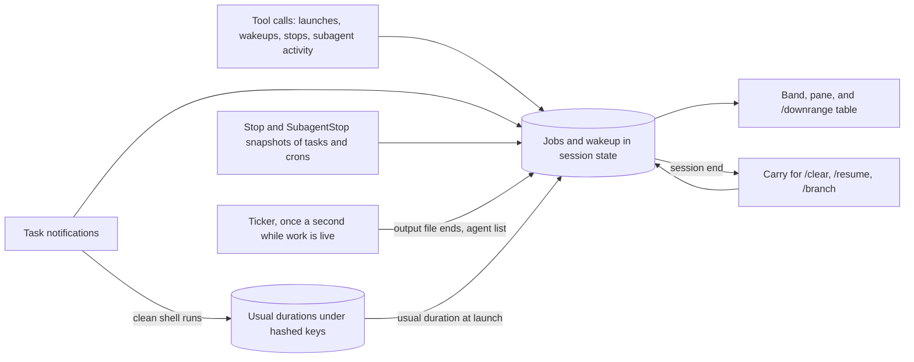

<p align="center"></p>

<p align="center">
  
  
  
  
</p>

<p align="center"><strong>Progress and an ETA for background shells and Monitor watches, read from their real output or past runs, with no model request.</strong></p>
<p align="center"><a href="#why">Why</a> · <a href="#features">Features</a> · <a href="#how-it-works">How it works</a> · <a href="#install">Install</a> · <a href="#commands">Commands</a> · <a href="#options">Options</a> · <a href="#how-it-compares">How it compares</a> · <a href="#known-limits">Known limits</a> · <a href="#privacy">Privacy</a></p>

> Vendored from [dot-agi/downrange](https://github.com/dot-agi/downrange) (MIT, by dot-agi). Install with `npx claude-code-templates@latest --mod observability/downrange`, or from the author's marketplace as described below. Installed with `--mod`, it loads as `downrange@skills-dir`: set its options in `/config`, or under `pluginConfigs["downrange@skills-dir"].options` in `~/.claude/settings.json`. Report issues upstream.


*The band above the prompt shows a background shell with its progress and ETA.*

## Why

Claude can run shell commands, Monitor watches, subagents, and workflows in the background while you keep working.
To see how far they got, you ask Claude, and that question costs a model request that reads the whole conversation again.
Users ask for progress and ETAs taken from the output itself ([#39131](https://github.com/anthropics/claude-code/issues/39131), [#82741](https://github.com/anthropics/claude-code/issues/82741)).
Downrange reads that output on your machine and shows where each job stands.

## Features

- **Progress from real output.** `45%`, `12/40`, and `Step 3 of 7` lines become a progress label, and a bar in the pane. Shell output and Monitor events both count.
- **ETA.** From the progress rate. With no rate yet, from the usual duration of the same command in the same folder, or from a Monitor watch's deadline. In the pane, a usual-duration ETA turns yellow once the run passes 1.5 times its usual duration.
- **The background tasks of your session.** Shell commands (`run_in_background`, ctrl+b, or a command moved at its timeout), Monitor watches, background and remote subagents, teammates, workflow runs, and the pending dynamic `/loop` wakeup. For background sessions, use agent view (`claude agents`).
- **Liveness flags.** `quiet 3m 00s` for a shell command or subagent that stayed silent for 2 minutes or more, and `3 failed calls in a row` for a struggling subagent.
- **A table that prints mid-turn.** `/downrange` answers at once, even while Claude works. With the `answerStatusPrompts` option on, a prompt such as `status?` gets the same table.
- **In step with Claude Code.** At each turn end, Downrange checks its rows against Claude Code's task list. It adds tasks it missed, and marks a job that left the list `ended without a report`. Running jobs carry across `/clear`, `/resume`, and `/branch`.
- **Read-only by design.** Downrange never stops or changes a task. Built-in `/tasks` stops tasks.


*The live pane lists a shell, a subagent, and a Monitor watch.*


*`/downrange` prints a status table at once, with no model request.*

The [usage guide](https://github.com/dot-agi/downrange/blob/main/docs/usage.md) explains every view, symbol, note, and message.

## How it works



- **Launches.** Hooks on the Bash, Monitor, Agent, and Workflow tools record each background launch with its id and title, and a shell's output file. A ScheduleWakeup result sets the wakeup. A TaskStop result marks its job stopped.
- **Output.** The ticker reads each running shell's output file every 2 seconds, or every 10 seconds above 256 KiB. It keeps the end of the file: the last 16,384 characters, or the last 16,384 bytes through `tail` above 4 MiB. Progress comes from the last 10 display lines of that end.
- **Ends.** Task notifications end jobs and carry Monitor events. The agent list updates subagent states. Stop and SubagentStop snapshots add tasks that Downrange missed, and end tasks that left the list after a 10-second grace period. A scheduled prompt that fires from 5 seconds before the wakeup's due time clears the wakeup. So does a snapshot with no one-shot schedule, after the same grace period.
- **Usual durations.** A clean end (exit code 0 or none) of a shell that Downrange saw start adds its run time to a history keyed by a hash of folder and command. The usual-duration ETA is the median of the last 5 runs.
- **Views and carry.** The band, the pane, and `/downrange` draw from the same state. The ticker stops when nothing is live. At session end, Downrange keeps the running jobs and the wakeup in memory, and restores them after `/clear`, `/resume`, or `/branch`.

## Install

Works with Claude Code 2.1.288 and later. Tested with Claude Code 2.1.296.

Inside Claude Code:

```text
/plugin marketplace add dot-agi/downrange
/plugin install downrange@downrange
/reload-plugins
```

From a shell:

```bash
claude plugin marketplace add dot-agi/downrange
claude plugin install downrange@downrange
```

From a clone, for one session:

```bash
git clone https://github.com/dot-agi/downrange
claude --plugin-dir ./downrange
```

## Commands

| Command or key | What it does |
| --- | --- |
| `/downrange` | Prints the status table at once, mid-turn too |
| `/downrange pane` | Opens or closes the live pane |
| `j` on the focused band | Opens the pane |
| `h` on the focused band | Hides the band until a new job starts |
| `c` in the focused pane | Clears finished jobs |
| `x` in the focused pane | Closes the pane |

Focus the band or the pane with Ctrl+X, then Tab, or a click. That chord is Claude Code's own `abovePrompt:focus` binding. Release Ctrl before you press Tab, because many terminals read Ctrl+Tab as next tab. In Emacs vterm, eat, or ansi-term, click the band, use `/downrange pane`, or rebind `abovePrompt:focus` with [`/keybindings`](https://code.claude.com/docs/en/keybindings#above-prompt-actions).

## Options

Set options in `/config`, or under `pluginConfigs["downrange@downrange"].options` in `~/.claude/settings.json`. For a `--plugin-dir` load, the key is `downrange@inline`. A `--mod` install loads the mod as `downrange@skills-dir`, so use that key in `~/.claude/settings.json` for that install.

| Option | Default | Effect |
| --- | --- | --- |
| `band` | `true` | Shows the band while background work is live |
| `answerStatusPrompts` | `false` | When Claude is idle and a job runs, answers an exact status prompt (`status?`, `what's the status?`, `give me a status update`) with the table. Send the same prompt again within 60 seconds to ask Claude |

## Where it runs

| Where | Band | Pane | `/downrange` | Local status answer |
| --- | --- | --- | --- | --- |
| Terminal, fullscreen | Yes | Docked from 110 columns, else above the prompt | Yes | When the option is on |
| Terminal, main screen | Yes | Above the prompt | Yes | When the option is on |
| Desktop app, Code tab | Yes | Yes | Yes | No |
| VS Code panel | No | Not verified; use `/downrange` | Yes | No |
| Agent SDK and stream-json sessions | No | No | Yes | No |
| Mobile app through Remote Control | No | Not verified; the terminal on your machine shows it | Yes | No |

## How it compares

| Feature or project | What it does | What Downrange adds |
| --- | --- | --- |
| Built-in [`/tasks`](https://code.claude.com/docs/en/commands) | An interactive dialog that lists and stops background shells, subagents, Monitors, and MCP tasks | Live progress, ETA, last output, the pending `/loop` wakeup, and a text table that prints mid-turn and in SDK sessions. Downrange does not stop tasks |
| Built-in [subagent panel](https://code.claude.com/docs/en/interactive-mode) | Rows of running background subagents below the prompt, with a key that stops them all | Shells, Monitors, wakeups, and progress |
| Built-in [`/workflows`](https://code.claude.com/docs/en/workflows) | A progress line per workflow run, and a view of its phases | Each workflow run as one row beside the other jobs. Downrange shows no phases |
| Built-in [agent view](https://code.claude.com/docs/en/agent-view) (`claude agents`) | Background sessions with their state, and the `/loop` run count and countdown. A `!cmd` shell job shows its last output line | The background tasks inside one session |
| [rabe](https://github.com/lorenzh/rabe) | A band and pane with subagents, workflows, background shells, Monitors, cron jobs, and `/loop` wakeups with the next run time. It can stop jobs and message agents, and it estimates cost per agent | Progress and ETA parsed from job output, a text table, and running jobs kept across `/clear`, `/resume`, and `/branch` |
| [Flotilla](https://github.com/Aleqsd/flotilla) | Bash, PowerShell, and Monitor background tasks with command, run time, and end state. An agent tree with model and cost, workflow bars, a timeline, and a stuck-agent alert | The last output line, progress, and ETA for shells, the `/loop` wakeup, quiet flags from output silence, and the carry across `/clear` |
| [claude-deck](https://github.com/barisdemirhan/claude-deck) | Shells and agents with run time, a stop button per shell, job steps as a tree, recently ended commands, cost and usage meters, and failure toasts | Monitor watches, the `/loop` wakeup, progress and ETA from output, and running jobs kept across `/clear` |
| [claude-flightdeck](https://github.com/scasella/claude-flightdeck) | A permission gate view, model vitals, and rich subagent cards and swimlanes | Progress and ETA read from the output of background shells and Monitors |
| [sprout](https://github.com/Tum4s/sprout) | Subagent cards with cost and a file tree. Its progress comes from a note it injects for Claude and a step tool that Claude calls | Progress read from real job output, with no tool or note for Claude |

## Known limits

Only dynamic `/loop` wakeups appear, and other schedules can clear or keep one. Progress and ETAs are guesses from output and past runs, and output silence, failed reads, late inputs, remote agents, closed teammate panes, and session changes can make a row wrong or stale.

<details>
<summary>Read all known limits</summary>

- **Only dynamic `/loop` wakeups.** Only wakeups that `ScheduleWakeup` creates appear. Fixed-interval loops such as `/loop 10m` and other cron schedules do not.
- **Other schedules and the wakeup.** Downrange cannot tell which schedule fired a scheduled prompt, or which one-shot schedule in a turn-end snapshot is the wakeup. A prompt of a scheduled task, a routine, or a fixed-interval loop that fires from 5 seconds before the wakeup's due time on clears the wakeup, even before the wakeup's own prompt fires. A cancelled wakeup that only a snapshot can clear stays while any other one-shot schedule remains. It then shows until a scheduled prompt fires near its due time, a new `ScheduleWakeup` result replaces it, or it is 10 minutes past due.
- **Progress read from output.** Progress is a guess from the text. A short date such as `10/11` counts as progress, unless a two-digit clock follows it, as in `10/11 14:03`. `N of M` followed by a space inside a path, such as `Disc 1 of 2 (live)/a.flac`, counts too, and so does another ratio or percentage that is not progress. These change the bar and the rate ETA. Full dates such as `2026/10/11` and `10/11/2026` do not count. Neither does `N of M` joined to a path or a number, such as `/backups/3 of 7/`, `version 1.2 of 7.0`, or `3 of 7.5 GB`. The date rule also drops real progress of 1 to 12 out of at most 31 before a clock, such as `3/15 00:12`.
- **Only the end of an output.** A direct read of a file up to 4 MiB keeps the last 16,384 characters (UTF-16 code units), which can be up to 48 KiB of non-ASCII text. A tail read above 4 MiB keeps the last 16,384 bytes. Progress and the last line come from that end. Long lines after a progress line can push it out.
- **ETAs during output silence.** When output stops, the bar keeps its last reading, and the rate ETA keeps counting down from the time of that reading. Once the estimate runs out, the ETA stays at `<1m` while the job runs. This holds after `quiet` shows too, so a row can show `20%`, `<1m`, and `quiet 2m 00s` together. A Monitor whose events stop behaves the same way.
- **Monitor deadlines and rate ETAs.** A Monitor watch shows its deadline only when it has no progress-based ETA. Once its progress gives a rate ETA, or reaches 100% and shows `finishing`, the deadline no longer shows. A rate ETA can run past the deadline: a 30-minute watch that goes from 1% to 2% in its first minute shows `~1h 38m`, although its deadline is 29 minutes away.
- **Time in the foreground before a move to the background.** A shell job's clock starts when the Bash call returns its background result. A command that first ran in the foreground, such as one moved at its timeout or with ctrl+b, loses that time. Its age, its `took` time, and the run it adds to the duration history count only the time after the move. For example, a command moved after 2 minutes that ends 1 minute later shows `took 1m 00s` and records 1 minute. Runs of one command in one folder share one history, whatever the launch mode. The next run of that command that starts in the background then shows `~1m usual`, even when it needs 3 minutes, and in the pane it can turn yellow early. A moved run can get a usual-duration ETA that is too long.
- **Duration history after a snapshot end.** A run adds to the duration history only when its completion notice arrives while its row still runs. When a turn-end snapshot already ended the row as `ended without a report`, the later notice marks it completed but adds no duration.
- **Simultaneous duration records.** Two sessions recording durations together can lose new runs, because the duration store has no versioned write. One lost write can hold several runs. When it held a command's first runs, that command keeps no history and shows no usual-duration estimate. Runs stored before both writes began remain, with their estimates.
- **Failed output reads.** While reads of a shell's output fail, its row shows no `quiet` flag and no rate ETA. When a shell job ends, Downrange reads its output one more time. If that read fails, Downrange does not try it again. The job can keep `output unavailable` or `tail failed` and the last line of an earlier read. Only a later ending, or a later notification that names the output file, asks for a new read.
- **Large outputs on Windows.** Outputs over 4 MiB need `tail` on PATH. Without it, such a job shows `tail failed`. A launch or end note that the job already shows, such as `backgrounded by you`, stays in its place; `claude --debug` still shows `cannot tail the output of task <id>`.
- **Tasks first seen in a snapshot.** Claude Code's turn-end snapshot can list a Monitor as a shell. A launch result is the result of the Bash or Monitor call that started a task. A Monitor first seen in a snapshot shows as a shell until its launch result, its first event, or its end notification arrives. Only its launch result gives it a deadline. A shell first seen in a snapshot shows no last line, progress, ETA, or `quiet` flag until its launch result or a notification names its output file. Only its launch result brings a usual-duration ETA. A task that started before Downrange loaded, such as one in a session moved to another process, gets no launch result. Claude Code's internal tasks also appear, under their engine labels, and a long-lived one can keep the band visible. Use **Hide** to dismiss the band.
- **`awaiting confirmation`.** A turn-end snapshot that leaves out a job younger than 10 seconds does not end it. The job keeps running with `awaiting confirmation` until newer input confirms or ends it, such as a later snapshot or a notification. The label does not expire on a timer.
- **Inputs that reach Downrange late.** Claude Code gives its events no shared sequence number. Downrange stamps each input with the time it receives it, and drops an input older than one it already applied to the same job. Hooks can overlap, so an end notification can land after a newer output read, agent list, or snapshot of its job. A completed, failed, or stopped notification of a shell, Monitor, or workflow still applies then, with its exit code, because such a task never runs again. Downrange drops a late end of an agent or a teammate, a `blocked` end, and the end of a remote task such as a remote workflow, because such a task can run again under its id. That row keeps running until a later agent list ends it, or a snapshot ends it as `ended without a report`, with no exit code or end note. A teammate can leave the agent list as it ends, so its row ends at the next turn-end snapshot. A notification does not add back a job that left the list, such as one you cleared. It still can when it lands during `/clear`, `/resume`, or `/branch`, before Downrange restores what it remembers, or when Downrange forgot the task (see the 2,000 tasks below). The row then comes back as running, with a `≥` age, until a later snapshot ends it.
- **Launch details that arrive late.** The same rule applies to launch results. A newer notification, Monitor event, snapshot, or output read of a task can land while Downrange still handles its launch result. Downrange then drops what the launch result adds. A Monitor then shows no deadline, and its age starts with `≥`. A shell can lose its usual-duration ETA, or its output file and launch note too, and that run adds nothing to the duration history. A notification that later names the shell's output file still brings back its last line.
- **Commands that subagents start.** A command with the note `ends with its agent` ends when its subagent answers. It then shows `ended with its agent` and no exit code, unless its own notification arrives later.
- **Agents that wait.** A subagent that the agent list reports as pending, waiting, or idle shows that word, beside its tool count when it shows one. It shows no `quiet` flag and no failed-calls flag, however long it stays in that state.
- **Agents that run elsewhere.** Downrange sees the tool calls only of agents that run in this Claude Code process. A remote subagent shows `remote`, and a teammate in a terminal pane of its own shows `own pane`. Their rows show no tool count and no `quiet` flag, so a stuck or dead one looks the same as a busy one. A row whose launch result Downrange missed, or that an earlier version of Downrange saved, still keeps `0 tools` and shows `quiet` from 2 minutes after launch, even while the agent works. Its notification or a snapshot still ends it.
- **A teammate whose pane closed.** A teammate in a terminal pane of its own writes `running` or `idle` in its team's roster. When that pane closes or dies, the roster keeps the last word. Its notification or a snapshot ends its row, but a later agent list read shows it running again. That read comes at each turn end, and every second while another agent runs. The row can then switch between ended and running, keep the band visible, and show `idle` with no end note. Check the teammate's own pane before you act on the row. Use **Hide** to dismiss the band.
- **A session moved to another process.** `/background` and a hand-off to the desktop app start a fresh process that resumes the conversation. Downrange starts empty there. Running tasks return at the next turn end, with `≥` ages and no last line. A shell's notification can still name its output file, end it, and show its last line. The `/loop` wakeup returns only with the next `ScheduleWakeup` result.
- **Changes during `/clear`, `/resume`, or `/branch`.** Downrange carries the jobs and the wakeup as it last wrote them before the old session ended. An update that lands during the change, such as a launch or a notification, can be lost. A later turn-end snapshot then adds a lost running task, with a `≥` age, and ends a task that left its list, as `ended without a report`. Downrange remembers the last 2,000 tasks that left its list, and forgets the oldest first. A task does not count toward the 2,000 while it is back in the list. These commands carry that memory to the next session. A finished job leaves the list through **Clear finished**, through the 20-job limit of **Finished**, or when you leave its session with one of these commands, which carry only running jobs. After `/resume`, a job that the resumed session last showed running can return, if 2,000 other tasks left the list after it, counted across all later sessions. The job shows `ended without a report`, or shows as running until the next turn end.
- **Another identity for the mod.** Claude Code keeps the duration history per plugin identity, `<plugin>@<marketplace>`. Installed from the `downrange` marketplace, Downrange is `downrange@downrange`. Loaded with `--plugin-dir`, it is `downrange@inline`. A copy under another identity, such as one installed from another marketplace, keeps a separate history, which starts empty. It shows no usual-duration ETA until it records runs of its own. The jobs and the wakeup live in session state under the plugin name `downrange`. A build under another plugin name cannot read them, so it starts with no jobs and no wakeup. A later turn-end snapshot brings running tasks back, with `≥` ages. The `/loop` wakeup returns only with the next `ScheduleWakeup` result.
- **Quoted failure text in task descriptions.** A failed or stopped task's description can contain quoted text followed by `failed:` or `was stopped:`, such as `Investigate "build" failed: exit code 2`. If Downrange first sees the task at its end, it can mistake description text for the end details. This also happens when an already tracked task's title was shortened or cleaned. The band, pane, and `/downrange` can show an incorrect title or exit code; end notes can hide the actual cause. Check the full task notification in the transcript before acting on those details. Use short task descriptions without quoted failure phrases to avoid this ambiguity.

The usage guide holds the same items under [Known limits](https://github.com/dot-agi/downrange/blob/main/docs/usage.md#known-limits).

</details>

## Privacy

Downrange watches events and changes almost none of them. It makes no network request, writes no file of its own, and adds no tool for Claude.

- **What it sends, and where.** Downrange itself sends nothing off your machine. Its output goes to your screen: the band, the pane, the `/downrange` table, the local status answer, and `downrange:` diagnostic lines in the transcript and the debug log. Two of these go further through Claude Code itself:
  - The `/downrange` table enters the conversation, so Claude reads it with its next request, as it reads any command output. The table cuts last output lines to 80 characters and removes control characters. A subagent row in the table shows only the tool it last used; the pane also shows that tool's input in short.
  - Where a remote surface draws the band or the pane, Claude Code sends that drawing to the surface.
- **The program it starts.** Only `tail -c 16384 <output file>`, with a 2-second time limit, to read the end of a large output. It runs only when a background shell's output file is over 4 MiB, the largest file Claude Code's file read accepts. It prints the last 16,384 bytes of that file. Downrange passes it as an argument list, with no shell. The output file path is the only part that varies. That path must be the output file of the job's own task id: absolute, in a `tasks` folder, and named `<task id>.output`. An organization policy that refuses mods which run host commands also refuses this mod.
- **Local data it reads.** The output files of background shells, with their size and change time. Its own duration store, a JSON file that Claude Code keeps for the mod in your Claude Code configuration folder. The session's working folder, only to hash it with a command. The list of the session's agents and their states.
- **Conversation data it reads.** The input and result of the tool calls in the hook table below: a command or description, the task id, the output file path, and the wakeup time and reason. One input field of each tool call a tracked subagent makes (see the last item). Task notifications. The `background_tasks` and `session_crons` lists of Stop and SubagentStop hooks. The text of a prompt you type, only when `answerStatusPrompts` is on, to compare it with the status phrases. Downrange reads no transcript file.
- **What it keeps.** Session state, which Claude Code holds for the session and which other mods in the session can read. It holds job titles, last output lines, notes, tool summaries, and the wakeup's reason, each cut to 200 characters or fewer. It also holds task ids, output file paths, progress, exit codes, times, and the last status prompt it answered. The duration store holds run times under a hash of folder and command, with no command text, no path, and no output.
- **Permissions.** Downrange never changes a permission decision. No hook denies or approves a call, rewrites a tool's input, or answers a permission prompt. Claude Code and you decide as before. `claude plugin validate` lists most hooks as gating hooks with a `.catch`, because their events can block. Each such `.catch`, such as the one on `classic.SessionStart` in `hooks/register.tsx`, only logs the failure and passes the event on unchanged with `next(e)`. The `/downrange` command and the Jobs pane show the failure instead.
- **The `Reflect.get` call in `hooks/jobs.ts`.** It reads one named field of a tracked subagent's tool input, from a fixed list in that file. The fields are `command` for Bash and Monitor, the file name from `file_path` or `notebook_path`, the `pattern` of Grep and Glob, the host of a WebFetch `url`, the `query` of WebSearch, and the `description` of Agent. That field becomes a summary such as `Edit: view.ts`, cut to 60 characters. Each tool's input has its own shape, so the code reads the field by name. It calls no function and reads no other field. Other tools show only their name.

<details>
<summary>Every hook, what it does, and what it changes</summary>

| Event | What the hook does | What it changes |
| --- | --- | --- |
| `session.start` | Registers `/downrange`, and loads the session's jobs and wakeup | Nothing |
| `session.end` | Keeps the running jobs and the wakeup in memory for the next session | Nothing |
| `classic.SessionStart` after `/clear`, `/resume`, or `/branch` | Puts the kept jobs and wakeup back, and starts the once-a-second timer | Nothing. It adds no context, instructions, or settings |
| `command.run` for `downrange` only | Prints the table for `/downrange`, and opens or closes the pane for `/downrange pane` | Only its own command |
| `tool.call` for Bash, Monitor, Agent, Workflow, ScheduleWakeup, and TaskStop | Lets the call run, then reads its result to record a background launch, the wakeup, or a stop | Nothing. The call's input and result stay as they were |
| `tool.call` for any tool | For a subagent that Downrange tracks, counts the call and keeps a short summary of it | Nothing |
| `session.append` | Reads a subagent's stored task notification to end jobs | Nothing |
| `turn.complete` | After a subagent answers, ends the commands tied to that answer and reads the agent list | Nothing |
| `prompt.submit` | Reads task notifications to end jobs, and a scheduled prompt to clear the wakeup | Only with `answerStatusPrompts` on: it drops an exact status prompt while Claude is idle and a job runs, and shows the table instead |
| `classic.Stop`, `classic.SubagentStop` | Reads the `background_tasks` and `session_crons` lists in the hook input to correct jobs and the wakeup | Nothing. It never blocks a stop |
| `ui.render` | Draws the band above the prompt and the Jobs pane | Adds the band on top of what the prompt area already shows. Draws only its own pane |

</details>

## Troubleshooting

<details>
<summary>Missing command, missing output, stalled ages, and debug lines</summary>

| Symptom | Cause | Fix |
| --- | --- | --- |
| `/downrange` is missing | Claude Code rejected command registration | Read the cause after `downrange: session.start: /downrange was not registered:` in the transcript. A built-in name conflict is one possible cause. Use the band's Open button |
| A job shows `no output file` | The tool result named no output file | Run `claude --debug` and search for `downrange: tool.call:` |
| A job shows `output unavailable` or `tail failed` | The output file is gone, or `tail` is not on PATH (common on Windows, for outputs over 4 MiB) | Run `claude --debug` and search for `downrange: clock.every:` |
| `/downrange pane` prints `The Jobs pane is not shown here` | Nothing draws in this session, or the surface places no panes | Use `/downrange` |
| Ages and output lines stop moving | Another mod refused a timer period | The next change starts the timer again; `claude --debug` shows `the ticker stopped` |
| Jobs end only when Claude's turn ends | Some Claude Code notices are plain text and carry no structured end status | No action for plain notices. If `claude --debug` shows `a task notification held no complete` or `unknown notification status`, report that line |
| A job shows `ended with its agent` | The background command of a subagent that Claude waited for ends when that subagent answers | Nothing |
| Something else looks wrong | A hook failed | The first failure of each hook shows as a dim `downrange:` line; `claude --debug` has every one |

The [usage guide](https://github.com/dot-agi/downrange/blob/main/docs/usage.md#troubleshooting) lists every message.

</details>

## Contributing

See [CONTRIBUTING.md](https://github.com/dot-agi/downrange/blob/main/CONTRIBUTING.md).

## License

[MIT](LICENSE). Copyright (c) 2026 dot-agi.
