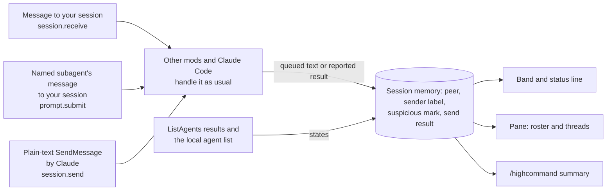

<p align="center"></p>

<p align="center">
  
  
  <a href="LICENSE"></a>
  
</p>

<p align="center"><strong>One inbox for agent-team teammates, named subagents, and other Claude Code sessions.</strong></p>
<p align="center"><a href="#why">Why</a> · <a href="#features">Features</a> · <a href="#how-it-works">How it works</a> · <a href="#install">Install</a> · <a href="#commands">Commands</a> · <a href="#options">Options</a> · <a href="#how-it-compares">How it compares</a> · <a href="#known-limits">Known limits</a> · <a href="#privacy">Privacy</a></p>

> Vendored from [dot-agi/high-command](https://github.com/dot-agi/high-command) (MIT, by dot-agi). Install with `npx claude-code-templates@latest --mod productivity/high-command`, or from the author's marketplace as described below. Installed with `--mod`, it loads as `high-command@skills-dir`: set its options in `/config`, or under `pluginConfigs["high-command@skills-dir"].options` in `~/.claude/settings.json`. Report issues upstream.


*The band above the prompt and the status line under it: 5 unread from scout, tester, and helper.*

## Why

When your session works with other agents, their messages arrive in the transcript one at a time, between your own turns. It is hard to see who wrote what, what you have not read yet, and what each of your sends reported. Users report teammate text that looked like their own turns ([#40166](https://github.com/anthropics/claude-code/issues/40166), [#28627](https://github.com/anthropics/claude-code/issues/28627)) and ask for a message inbox ([#100724](https://github.com/anthropics/claude-code/issues/100724)). High Command groups these messages by peer, says how far Claude Code vouches for each sender, and shows the reported result of each plain-text send.

## Features

- **One inbox by peer.** Messages from agent-team teammates, from subagents that message your session by name, and from your other Claude Code sessions, grouped by peer with unread counts. Read them in a pane, or print a summary with `/highcommand`.
- **Band and status line.** While unread messages wait, a row above the prompt shows the count and up to three peers, with **Open**, **Read all**, and **Hide**. **Hide** puts the band away until a newer message arrives and marks nothing read. The status line under the prompt, `high-command: 5 unread (retained)`, is the mod's own line, so another mod's band cannot hide it. It clears at zero. Both count the main inbox. The `agentLanesInBand` [option](#options) adds the unread messages of agent lanes.
- **Pane with threads.** A roster of the peers you received messages from or tried to message: peers with unread messages first, then the most recent. Each row shows the unread count, the sender label, any `suspicious` mark, the time of the latest message, the peer's last known state, and the start of that message. Open a peer to read its thread, newest first: its messages to you and Claude's sends to it, each send with its reported result. Messages that were unread when you opened the thread, and messages that arrive while it is open, stay marked `new` until you go back to the roster.
- **Sender labels.** Each message to you gets a label from Claude Code's own record of where it came from. The sender name is a claim. The label says how far Claude Code vouches for it:
  - `verified sender`: a teammate whose message the team harness wrote under that name.
  - `local sender`: another session or agent whose message Claude Code delivered. Claude Code does not report the sender's host, so a remote session's message can have this label too.
  - `unverified sender`: everything else, such as a message that a mod in the sender's session wrote outside a verified team mailbox, or a delivery that Claude Code could not place. Teammates in their own split panes (tmux or iTerm2) write through a file that Claude Code cannot check, so their messages always get this label.

  The message text can lower a label but never raise one: a message that names a different teammate than the one that sent it is `unverified sender`. A peer's row and `/highcommand` show the weakest label among its unread messages, so a newer message cannot hide a warning.
- **Suspicious marks.** A message that matches a short fixed list of text patterns is marked `suspicious` in its thread, and on its peer's row while it is unread. The list covers some wordings that tell an agent to ignore its earlier instructions, to change the permission mode, to run a download in a shell, or to read a credential file, and long base64 blocks. The check ignores these invisible characters: Unicode format characters (category Cf, such as a zero-width space or a soft hyphen), the combining grapheme joiner U+034F, and the variation selectors U+FE00 to U+FE0F and U+E0100 to U+E01EF. It tests the text once with each of them read as a space and once with each removed, and marks the message when either test matches. Other invisible characters, look-alike letters from another alphabet, and one wording with these characters both inside a word and between two words can still avoid the mark. Other wording with the same aim gets no mark, so a message without the mark can still try to steer an agent. The mark is for you alone: it hides no text and changes nothing that Claude reads.
- **Idle notices and peer states.** A teammate's idle notice with no content only updates its state. A notice that carries the teammate's final answer or failure shows as a message. When Claude runs ListAgents, High Command notes the state of each listed peer, such as busy, idle, or offline, and shows it on that peer's row once the peer has messages.
- **Read-only.** High Command never starts a model turn and never changes a message, a send, or a tool result.


*The roster: three peers with unread counts and sender labels.*


*The helper thread, newest first, shows its message and finished notice.*

## How it works



- **Messages in**: High Command records each message to your main conversation after Claude Code and the other mods have handled it, so it shows the text that Claude reads. In Claude Code 2.1.296, a named subagent's message does not pass `session.receive`. Claude Code submits it as a prompt from a peer, so High Command reads it in `prompt.submit`, both while the session is idle and during a turn. Task notifications, scheduled prompts, and your own Remote Control prompts are not recorded. A message that another mod consumes, or that you decline in an approval dialog, never reaches Claude, so High Command does not record it.
- **Messages out**: each plain-text SendMessage that Claude makes in your main conversation, with its reported result. A message to an agent that has no name, and a message that another mod in your session sends, are not recorded. [Known limits](#known-limits) names the other sends that High Command cannot see.
- **Agent lanes**: local agents' messages go to one lane per agent. The pane opens on the main inbox. Its agent selector switches lanes, and the pane stays on the lane you pick, also when you view an agent's transcript.
- **Unread**: a message is unread until you open its peer's thread, press **Mark read** in that thread, or press **Read all**. Messages that Claude sends are never unread.

## Install

Works with Claude Code 2.1.288 and later. Tested with Claude Code 2.1.296.

Agent teams are optional. Turn them on with `CLAUDE_CODE_EXPERIMENTAL_AGENT_TEAMS=1`.

Inside Claude Code:

```text
/plugin marketplace add dot-agi/high-command
/plugin install high-command@high-command
```

From a shell:

```sh
claude plugin marketplace add dot-agi/high-command
claude plugin install high-command@high-command
```

For one session from a clone:

```sh
claude --plugin-dir ./high-command
```

### Agents and scripts

Install from a shell with Claude Code 2.1.292 or later. The second part turns on auto-update. It runs only when the install succeeds and the marketplace entry exists:

```sh
claude plugin install high-command --marketplace dot-agi/high-command --scope user --json \
  && f="${CLAUDE_CONFIG_DIR:-$HOME/.claude}/settings.json" \
  && jq -e --arg name high-command '.extraKnownMarketplaces[$name].source' "$f" > /dev/null \
  && tmp=$(mktemp "$f.XXXXXX") \
  && { jq --arg name high-command '.extraKnownMarketplaces[$name].autoUpdate = true' "$f" > "$tmp" && mv "$tmp" "$f" || { rm -f "$tmp"; false; }; }
```

Claude Code 2.1.288 to 2.1.291 has no `--marketplace` option. Add the marketplace first, then run the auto-update part above, from `f=` on:

```sh
claude plugin marketplace add dot-agi/high-command --scope user --json \
  && claude plugin install high-command@high-command --scope user --json
```

Auto-update runs only in interactive sessions. A headless job updates at its start, before the session that uses the mod:

```sh
claude plugin update high-command@high-command --json
```

- New code loads in the next session, or after `/reload-plugins`.
- Running `install` again does not update. Use `update`.
- On a host with no SSH key for GitHub, set `CLAUDE_CODE_PLUGIN_PREFER_HTTPS=1` in the environment of every `claude` command and session.
- The auto-update part replaces `settings.json` with a new file with mode 600. If `settings.json` is a symbolic link, edit its target instead.

## Commands

| Command | What it does |
| --- | --- |
| `/highcommand` | Prints the summary: one row per peer with its unread count, the time of its latest message, its state, and the kind of its latest message. Runs at once, even during a turn. |
| `/highcommand open` | Opens the pane on the first page of the main inbox roster. In `claude -p`, it explains that no pane can draw. |

### Keys

| Key | Where | Action |
| --- | --- | --- |
| Ctrl+X, then Tab | Anywhere | Move the keyboard to the band or the pane. This is Claude Code's own focus chord. |
| `o` | Band | Open the pane |
| `r` | Band or pane roster | Mark every message read |
| `h` | Band | Hide the band until a newer message arrives |
| `1`-`9` | Pane roster | Open the thread of that peer |
| `b` | Pane thread | Back to the roster |
| `r` | Pane thread | Mark that peer read, only while **Mark read** shows |
| Esc | Band or pane | Give the keyboard back to the prompt |

Release Ctrl before you press Tab, because many terminals read Ctrl+Tab as next tab. In Emacs terminals, Ctrl+X goes to Emacs: click the band, run `/highcommand open`, or rebind `abovePrompt:focus` with [`/keybindings`](https://code.claude.com/docs/en/keybindings#above-prompt-actions).

Letter and digit keys work only while the band or the pane has the keyboard. **Open** in the band opens the pane but leaves the keyboard on the band, and focus passes each band button before it reaches the pane. Press Ctrl+X, then Tab, until the pane border shows focus, or click the pane, before you press a digit. Each letter and digit key also has a button you can click. The full guide is [docs/usage.md](https://github.com/dot-agi/high-command/blob/main/docs/usage.md).

## Options

Set options in `/config`, or under `pluginConfigs["high-command@high-command"].options` in `~/.claude/settings.json`. For a `--plugin-dir` load, the key is `high-command@inline`. A `--mod` install loads the mod as `high-command@skills-dir`, so use that key in `~/.claude/settings.json` for that install.

| Option | Default | Effect |
| --- | --- | --- |
| `agentLanesInBand` | `false` | Adds the unread count of all agent lanes to the band and the status line, as in `high-command: 3 unread (retained) · 2 unread in agent lanes`. **Read all** in the band then also marks every agent lane read. **Hide** then also ends when a newer message arrives in an agent lane. **Open** still shows the main inbox. |

A change takes effect at once: Claude Code reloads the mod with the new values.

## How it compares

Claude Code and other mods also show peer messages. Each row says what the tool does and what High Command adds.

| Tool or feature | What it does | What High Command adds |
| --- | --- | --- |
| Built-in `Message from` rows in the transcript ([cross-session messaging](https://code.claude.com/docs/en/cross-session-messaging)) | One dim preview line per message with the sender name. Ctrl+O expands it. | Messages grouped by peer, unread counts, sender labels, and the reported result of each plain-text send. |
| Built-in `/list-agents` (`/peers`) ([cross-session messaging](https://code.claude.com/docs/en/cross-session-messaging)) | Lists subagents, teammates, and local and remote sessions, with offline status. | The messages of each peer. When Claude runs ListAgents, the reported state shows on that peer's roster row. |
| Built-in agent panel ([agent teams](https://code.claude.com/docs/en/agent-teams)) | Lists teammates and subagents. Enter opens one teammate's transcript. | One inbox across teammates, named subagents, and other sessions. |
| [session-orchestra](https://github.com/atarazevich/session-orchestra) | A read-only mod with session cards (working or idle state, model, effort, context bar), subagent cards, and a message list with a full-message view and a copy button. It reads transcripts and runs in a terminal. | Unread counts, sender labels, suspicious marks, and the reported result of each plain-text send. High Command reads no files, and its pane also draws in the desktop app, the VS Code panel, and the mobile app. |
| [claude-crosstalk](https://github.com/kbrdn1/claude-crosstalk) | A mod with a per-peer inbox for cross-session messages, unread counts, a status line, and a reply field that sends through SendMessage. It keeps history across restarts and `--resume`, rebuilt from the session journal. | Teammates and named subagents in the same inbox, sender labels, suspicious marks, and the reported result of each plain-text send. High Command sends nothing and keeps no history past the conversation. |

## Known limits

### What it catches

- **Messages to you**: from agent-team teammates, named subagents, and your other sessions, by peer, with a sender label.
- **Claude's sends**: each plain-text SendMessage in your main conversation, with its reported result.
- **Local agents**: the messages each local agent sends and receives, in a lane of its own.

### What it does not catch

- **Earlier history**: messages from before this session, or from before `/clear`, `/resume`, or `/branch`.
- **Some sends**: structured sends such as `shutdown_request`, and sends by other mods or by agents that a mod started.
- **Split-pane traffic**: messages between teammates that run in their own tmux or iTerm2 panes.
- **Proof of reading**: a queued send does not show that the peer read it, and a peer state can be out of date.
- **Every steering attempt**: the `suspicious` mark covers a short list of wordings, and other wordings get no mark.

The list below holds the limits you can hit in daily use. [docs/usage.md](https://github.com/dot-agi/high-command/blob/main/docs/usage.md#known-limits) has every limit, also the rare ones: size caps, unusual names and frames, changes by other mods, and display gaps.

<details>
<summary>Read the limits you can hit in daily use</summary>

- **Agent lanes**: messages that local agents send and receive go to a separate lane for each agent. Each lane has its own counts and read marks. The pane shows each lane's unread count on that agent's button, and `/highcommand` lists the counts apart from the main inbox. By default, the band, the status line, and **Hide** cover the main inbox only, so an unread message in an agent lane does not show there. The `agentLanesInBand` [option](#options) adds the unread count of all agent lanes to the band and the status line. A message between your main conversation and a local agent can show twice, once in the main inbox and once in that agent's lane. The lane copy of a message from your main conversation never counts as unread. High Command does not see messages between teammates that run in their own split panes.
- **Local agent status**: the status under each agent button in the pane, and in `/highcommand`, names its source. A `roster snapshot` status comes from Claude Code's local agent list. High Command reads that list when you open the pane or run `/highcommand`, when an agent starts, and when an agent ends a turn. Between reads, the status can be old. When two reads overlap, the older one can bring back an agent that the newer one removed. Open the pane or run `/highcommand` again after agent activity settles. A `lifecycle observation` says how an agent's last turn ended, such as `turn answered` or `turn error`. When the list does not hold an agent that ended a turn, an open pane shows that observation as the agent's status until the next read of the list. It describes a finished turn, so it does not prove that the agent still runs. A teammate in its own split pane can keep its last status after it crashes. `/highcommand` lists up to 100 local agents. The pane pages through all of them, 10 at a time.
- **Peer states**: a peer's roster row shows only states from teammates' notices and ListAgents results, never the local agent status. A state is the last one reported, with its time, so it does not prove that the peer is in that state now. When two rows of one ListAgents result have the same name, High Command cannot tell whose state is whose. When the result lists its rows as data, High Command takes no state for that name, so a state recorded earlier, such as `offline`, stays on that peer's row. When the result holds only the printed listing, that name gets the state of the last such row that has one.
- **Send results**: a send shows the recipient and text that High Command observed, and the result reported back to High Command. **Send details** shows what Claude Code itself received, which another mod may have changed, and whether Claude Code queued the message. When a mod answers the send itself, Send details cannot show this. When a mod sends the message more than once, Send details covers only one of those sends. A refused send shows the first 120 characters of the reason, on one line, in its header. **Send details** keeps up to 2,000 characters of the reason, with its line breaks, and says when it was cut. A queued message is not proof that the peer read it.
- **Structured sends**: Claude Code passes only plain-text SendMessage messages to High Command. A SendMessage whose message is a `shutdown_request`, `shutdown_response`, or `plan_approval_response` object does not reach it. Neither its attempt nor its result appears in the main inbox, an agent lane, or `/highcommand`. Check the transcript for these sends.
- **No earlier history**: High Command starts empty in each new session and conversation. `/clear`, `/resume`, and `/branch` empty it again, so a resumed conversation shows none of its earlier messages. The pane and `/highcommand` say when the capture window began. After these commands, they also say that earlier history was not restored.
- **Display only**: High Command changes nothing that Claude reads. Its inbox leaves out idle notices with no content, but Claude still reads them, so the inbox saves no model turns or tokens.

</details>

## Privacy

- High Command makes no network, file, process, or model call of its own, and it keeps nothing on disk. It reads no credential, token, settings file, environment variable, or other file. The `suspicious` patterns in `hooks/text.ts` name credential files, such as `.aws/credentials`, only to mark a message that asks an agent to read one.
- Besides the events in the table below, it reads the local agent list (each agent's ID, name, status, and the mod that started it) to file sends, label subagent messages, and show each local agent's status. It reads which surfaces show the session, so `/highcommand open` can say when no pane can draw. It also reads the clock and its own session state.
- It keeps up to 200 messages in the main inbox and in each agent lane, and the states of up to 100 peers, in session memory. A message, a refusal reason, and the text in **Send details** keep at most 2,000 characters each, with control characters removed. `/clear`, `/resume`, `/branch`, and the end of the session drop them.
- A pane that you open in the desktop app, the VS Code panel, or the mobile app is drawn there, as the transcript is.
- `/highcommand` output reaches Claude as command output. It holds counts, times, states, and peer and agent names, never message text. Names show as code, so a name cannot add a link or formatting.
- High Command never orders, highlights, or counts a message by a priority or urgency that its sender claims.

### What High Command hooks

The first eight hooks below pass their event on with `next(e)` and return the result unchanged. The last two answer `/highcommand` and draw High Command's own views.

| Event | What the hook does |
| --- | --- |
| `session.start` | Registers `/highcommand`, starts the capture window, and sets the status line. |
| `classic.SessionStart`, on `/clear`, `/resume`, and `/branch` | Starts a new capture window and sets the status line again. It adds no context, instructions, or settings. |
| `session.receive` | For a message from a peer, records the text that Claude Code queues for Claude. |
| `prompt.submit`, for peer prompts | Records a named subagent's `<agent-message>` prompt, and reads the local agent list for its sender label. It submits no prompt. |
| `session.send`, for Claude's sends | Records each plain-text SendMessage attempt and its reported result. |
| `tool.call`, for ListAgents | Reads the peer states in the result. |
| `agent.spawn` | Reads the local agent list after the agent starts. |
| `turn.complete` | When a local agent's turn ends, reads the local agent list and notes how the turn ended. |
| `command.run`, for `/highcommand` | Prints the summary, or opens the pane. |
| `ui.render`, for its own pane and the area above the prompt | Draws the pane, and the band above other mods' content. During a survey, or when the band does not fit, it leaves that area as it was. |

High Command has no hook on a permission check, so it never changes a permission decision. Its `agent.spawn` hook only reads the local agent list after the spawn. It never changes an agent's prompt, type, model, or permission mode, and it never refuses a spawn.

## Troubleshooting

<details>
<summary>Loading checks, unnamed peers, missing bands, and diagnostics</summary>

- **Nothing appears**: run `claude plugin test` in an empty folder. `no hooks module to load` means mods can load on your machine. Then check that the `mods active` line in `/plugin` names high-command.
- **`claude plugin test` says hooks modules are turned off**: mods cannot load. `turned off here` means a setting or your organization's policy blocks them. `turned off in this process` means installed mods are off: start `claude` once with network access, then run the check again. If the message stays, installed mods are turned off remotely, and no setting on your machine turns them back on.
- **A peer shows as `unnamed peer`**: the delivery carried no sender name. Start Claude Code with `--debug`. Each such delivery writes `high-command: session.receive: a <kind> delivery named no sender` to the debug log, or the same line with `prompt.submit` for a subagent's message. Please open an issue with your Claude Code version and that line.
- **No band in VS Code or the mobile app**: these surfaces draw no band. Use `/highcommand open` for the pane, or `/highcommand`.
- **High Command is empty after `/clear`, `/resume`, or `/branch`**: High Command holds the current conversation only.
- **`claude -p "/highcommand"` shows no messages**: a `-p` run reports only the messages of that run. Use `/highcommand` in a long-running session or an SDK host.
- **A `high-command:` line in the transcript**: it names the event and the cause of a failure. The transcript shows each distinct line once until the mod loads again, and repeats go to the debug log only. Errors that `/highcommand` prints show every time. Start Claude Code with `--debug` to see every line.
- **A debug line names high-command after you decline a message**: Claude Code reports the declined delivery under each mod that passed it on. High Command records nothing for that message.
- **A harmless message is marked `suspicious`**: the patterns are a short fixed list, so a normal message can match. The mark blocks nothing.
- **The band is gone but the status line still counts messages**: you pressed **Hide**, and the band comes back with the next message. The band also gives way to a Claude Code survey and to large drawings by other mods (see [Known limits](https://github.com/dot-agi/high-command/blob/main/docs/usage.md#known-limits)). `/highcommand open` shows the pane, and **Read all** there clears the main inbox count. With the `agentLanesInBand` [option](#options) on, the line also counts agent lanes. To clear them, press each agent's button that shows an unread count, then **Read all** in its lane. **Read all** in the band, when it shows, clears both counts.

</details>

## License

MIT. See [LICENSE](LICENSE).
