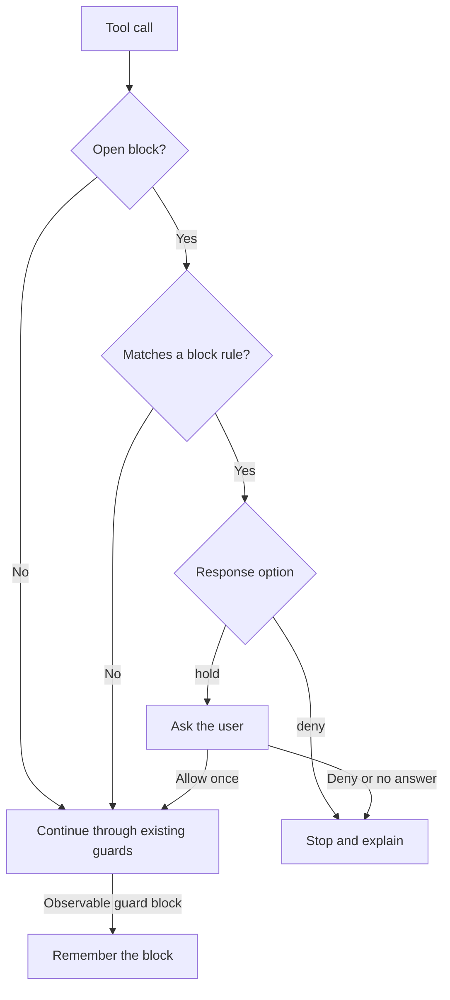

<p align="center"></p>

<p align="center">
  
  
  <a href="LICENSE"></a>
  
</p>

<p align="center"><strong>Arrester remembers your guards' blocks and stops common detours to the same target.</strong></p>
<p align="center"><a href="#why">Why</a> · <a href="#features">Features</a> · <a href="#how-it-works">How it works</a> · <a href="#install">Install</a> · <a href="#commands">Commands</a> · <a href="#options">Options</a> · <a href="#known-limits">Known limits</a></p>

> Vendored from [dot-agi/arrester](https://github.com/dot-agi/arrester) (MIT, by dot-agi). Install with `npx claude-code-templates@latest --mod security/arrester`, or from the author's marketplace as described below. Installed with `--mod`, it loads as `arrester@skills-dir`: set its options in `/config`, or under `pluginConfigs["arrester@skills-dir"].options` in `~/.claude/settings.json`. Report issues upstream.


A deny rule blocks cat. Arrester stops the head detour.

## Why

A guard can block one tool call while a different tool still reaches the same file, as reported in [Claude Code issue #29709](https://github.com/anthropics/claude-code/issues/29709).
Arrester remembers supported blocks from a settings hook, a deny rule, auto mode, or your own “No” in the permission dialog, within the [capture limits](#known-limits), and checks later calls against them.
A safe alternative that matches none of Arrester's rules goes on to your guards. A recognized detour to the blocked target stops.

## Features

- **Follows the guards you have.** Uses the blocks of your existing hooks, deny rules, and auto mode, so you write no new rules.
- **Matches across tools.** Recognizes common shell rewrites and file-tool calls that reach a blocked path.
- **Protects your guards.** While a block from a hook, rule, or classifier is open, stops recognized reads or changes of guard files, and `claude` commands that can turn guards off.
- **Checks subagents.** Applies the same rules to tool calls from subagents in the conversation.
- **Explains each stop.** Tells Claude which block the call matched and why. `/arrester` shows the open blocks and the recent decisions.
- **Denies or asks.** Refuses a match at once, or holds it until you answer.

## How it works



- **Capture:** Arrester records the blocked call's paths, the access to each (read, write, or delete), and the shape of its command.
- **Match:** A later call matches when it reaches a blocked target, repeats the blocked command with changed flags or argument order, reads or changes a guard, or is opaque: it runs code or names paths that Arrester cannot read. A retry that only drops flags skips the retry rule; the other rules and your guards still apply.
- **Guards:** The guard files are your user and project settings files, the hook scripts that your settings name by an absolute path, Arrester's own folder, and your installed plugins (changes only). A nested `claude` command with `--settings`, `--bare`, `--safe-mode`, `--dangerously-skip-permissions`, `--allow-dangerously-skip-permissions`, or `--permission-mode bypassPermissions` also counts, and so do `claude plugin disable`, `claude plugin uninstall`, and `claude plugin configure … --values-stdin`.
- **Your “No”:** Arrester stops only an exact retry of the call you rejected, so a changed request can go on. The target, guard, and opaque rules do not apply to it.
- **Lifetime:** A block closes after `block_minutes` (see [Options](#options)), or when you run `/arrester clear`. `/clear`, `/resume`, and `/branch` start a fresh record.
- **No open block:** Arrester passes calls through without analyzing them.

See the [usage guide](https://github.com/dot-agi/arrester/blob/main/docs/usage.md#how-a-later-call-is-checked) for access rules, supported shell forms, and script handling.

## Install

Works with Claude Code 2.1.288 and later. Tested with Claude Code 2.1.296.

Inside Claude Code:

```text
/plugin marketplace add dot-agi/arrester
/plugin install arrester@arrester
```

From a shell:

```sh
claude plugin marketplace add dot-agi/arrester
claude plugin install arrester@arrester
```

To try it for one session from a clone:

```sh
git clone https://github.com/dot-agi/arrester
claude --plugin-dir ./arrester
```

## Commands

| Command | What it does |
| --- | --- |
| `/arrester` or `/arrester status` | Shows the open blocks, the held calls, and the last ten decisions. |
| `/arrester history [1-5]` | Shows ten retained decisions per page, newest page first, with clipped detail. |
| `/arrester clear` | Closes every open block. |
| `/arrester clear b2` | Closes block b2. |

Only you can run `clear`. Arrester accepts it from your own prompt, from Remote Control, and from an SDK host: the desktop app, the VS Code panel, `claude -p`, or a program of your own on the Agent SDK. It refuses `clear` from every other origin, such as a scheduled task or another session.


`/arrester status` lists the open block and recent stops.

## Options

Set them in `/config`. From a shell, write the values to a JSON file and run `claude plugin configure arrester@arrester --values-stdin < values.json`.

| Option | Values | Default | What it does |
| --- | --- | --- | --- |
| `response` | `deny`, `hold` | `deny` | `deny` refuses a match at once and tells Claude to stop and ask you. `hold` asks you first, with `Deny` and `Allow once`; `Allow once` still sends the call through every guard. Where nobody can answer (`claude -p`), `hold` refuses. |
| `block_minutes` | 1 to 1440 | 30 | How long a block stays open after it opened or after its last target or retry match. |

## How it compares

Arrester remembers supported guard blocks within the current conversation. These tools provide complementary checks and controls.

| Tool or feature | What it does | What Arrester adds |
| --- | --- | --- |
| Built-in [`/permissions` Recently denied](https://code.claude.com/docs/en/permission-modes#when-auto-mode-falls-back) and the [`PermissionDenied` hook](https://code.claude.com/docs/en/hooks#permissiondenied) | Lists auto mode denials, which you can retry with your approval; the hook runs on each auto mode denial. | Checks later calls against a recorded block, including recognized routes through other tools. |
| Built-in [protected paths](https://code.claude.com/docs/en/permission-modes#protected-paths) | Never auto-approves writes to protected folders such as `.git` and `.claude`, except in `bypassPermissions` mode and in some sessions where that mode is available. | While a block from a hook, rule, or classifier is open, also stops recognized reads of guard files and recognized guard-changing commands. |
| [Termaxa](https://github.com/termaxa/termaxa) | Applies command policies, previews consequences, and uses a circuit breaker for repeated destructive intent across shells and sessions. | Follows supported blocks from other guards and matches their specific file targets. |
| [melodic-software guardrails](https://github.com/melodic-software/claude-code-plugins/blob/main/plugins/guardrails/README.md) | `block-hook-bypass` checks Bash writes that bypass Write/Edit hooks; other guards check file changes. | Remembers a prior block and checks later calls against its targets across tools. |
| [destructive_command_guard (dcg)](https://github.com/Dicklesworthstone/destructive_command_guard) | Uses rule packs to block destructive commands, with explanations and allow-once controls. | Follows observable hook blocks and stops common attempts to reach the blocked target another way. |
| [guard-and-guide](https://github.com/kawarimidoll/guard-and-guide) | Uses configurable regular-expression rules to deny commands and suggest safer alternatives. | Checks whether a later alternative matches an open block's target or another block rule. |

## Known limits

Arrester catches common retries after a block. It is not a sandbox and cannot recognize every shell rewrite.

<details>
<summary>Read the full detection, capture, and capacity limits</summary>

Most of these limits apply while a block from a hook, deny rule, or auto mode classifier is open. In hold mode, `Allow once` still runs every guard. In deny mode, inspect the call and its block with `/arrester`; clear that specific block only if you intend to end its protection.

- **Pipeline failures (`pipefail`):** With `bash -o pipefail` or `set -o pipefail`, Arrester uses only the last pipeline command's result. It can miss a protected read after `||`, or falsely stop an `&&` branch that Bash would skip. Check these branches yourself and ask Claude to use explicit paths in separate calls after you approve the intended work.
- **Input inherited by command substitutions:** When `$(cat)` reads a path from the surrounding shell's heredoc, Arrester loses that input. A later read through the assigned variable can pass without an Arrester stop or warning. Ask Claude to state the path explicitly so you and the guards can check the intended read.
- **Command-substitution assignments:** Arrester loses the success or failure result of an assignment such as `p=$(true)` or `p=$(false)`. It can falsely stop a protected action after `||` or `&&` that the shell would skip. Inspect the conditional branch before choosing `Allow once` in hold mode.
- **Exit on failure (`errexit`):** With `bash -e` or `set -e`, Arrester can still check commands after a failure that would end the shell. It can falsely stop a later deletion that Bash would never run. Confirm that the failure exits the shell in that context before choosing `Allow once` in hold mode.
- **Pathname text helpers:** While a read block is open, `basename` or `dirname` on the protected path can trigger a false stop. On a guard file, they can also trigger a guard-file stop, although they only transform pathname text. Check that the whole call only handles text before choosing `Allow once` in hold mode.
- **Searches that name no folder:** A recursive search with no folder operand, such as `rg pattern`, `grep -r pattern`, `ag pattern`, or a Grep call without `path`, searches the current folder. Arrester records no read for it, so it can read a file under a read block in that folder without a stop or a warning. The same search with the folder named, such as `rg pattern /work`, stops. Ask Claude to name the search folder, and check searches without one yourself while a read block is open.
- **Copies into a folder:** When the destination of a copy or link is a folder, such as in `cp /work/staging/secret /work/` or `cp -t /work /work/staging/secret`, Arrester records a write to the folder only. It does not record the file that the copy makes there, so the copy can replace a file under a write or deletion block without a stop or a warning. Under a deletion block, a move or a recursive copy into the folder also passes. A destination that names the file, such as `/work/secret`, stops. Ask Claude to name the destination file, and check copies into the folder of a protected file yourself.
- **Running or sourcing a script:** Running or sourcing a script does not count as a read of the script file. Arrester checks the commands inside the script instead. So `bash -v /guards/check.sh`, which prints a guard script's text, and `. /guards/check.sh` pass without a guard stop. A script under a read block can be printed the same way without a target stop. `cat /guards/check.sh` and `bash -n /guards/check.sh` still stop. Check calls that run or source a guard script or a protected script yourself, especially with `-v` or `-x`.
- **Failed folder changes:** Arrester assumes that every `cd` or `pushd` succeeds. When the folder does not exist, the shell stays where it was, but Arrester resolves later relative paths in the missing folder. In `/work`, with `/work/secret` under a read block, `cd /missing || head secret` and `cd /missing; head secret` read `/work/secret` without a stop or a warning. A write or a deletion of `secret` there passes the same way. Ask Claude to use absolute paths after a `cd` that can fail, and check relative paths in such fallbacks yourself.
- **Prefix assignments that the shell keeps:** Arrester treats an assignment written before a command, such as `p=/work/secret export p`, as temporary. Some shells keep it. Bash keeps it before `export p` or `readonly p`, and `sh`, `dash`, and `ksh` keep it before any special built-in command, such as `export`, `eval`, `set`, or `:`. Arrester then does not know the value. With `/work/secret` under a read block, `sh -c 'p=/work/secret export p; head "$p"'` reads the file without a stop or a warning. A deletion through `$p` still stops as opaque. Ask Claude to write `export p=/work/secret`, or `p=/work/secret; export p`, which Arrester follows.
- **Relative names with a colon:** Arrester treats a command operand with a colon before its first slash as a remote target, such as `host:path` or a URL, and checks no file for it. So a relative file name such as `2026-10-11:notes.txt` or `dir:x/file` gets no check as an operand. In `/work`, with `/work/2026-10-11:notes.txt` under a block, `head 2026-10-11:notes.txt`, `cp /a 2026-10-11:notes.txt`, and `rm 2026-10-11:notes.txt` pass without a stop or a warning. A redirection such as `< 2026-10-11:notes.txt`, the name with `./`, and the absolute path still stop. Ask Claude to write such names with `./` or as absolute paths, and check colon names in shell commands yourself.
- **Repeated brace groups:** Arrester counts every word that brace expansion makes before it removes repeats. A word whose braces make more than 256 words is opaque, even when every word names the same path. For example, `cat /work/` followed by nine `{s,s}` groups makes 512 words that all name `/work/sssssssss`. While a block from a hook, rule, or classifier is open, such a call stops with the reason `the call names too many paths to read`. Ask Claude to write the path without repeated brace groups, or to split the call.

- A blocked recursive read or listing, such as `grep -r` or a Grep or Glob call, records no target, so the target rule never matches its block.
- Arrester reads paths only from Bash, Monitor, Read, Write, Edit, NotebookEdit, LSP, Grep, Glob, SendFile, and SendUserFile calls. A call of any other tool, such as an MCP tool, gives no paths, so the target and guard rules cannot match it.
- Your “No” matches only an identical call: the same command text, working folder, and relevant tool arguments. A command that differs by one character goes on to your guards. Tool input past the serialization limits gets no exact identity, so your “No” on such a call matches no retry.
- Managed-settings hook denials end before installed mods run, so Arrester cannot observe them. With managed settings on the machine, or with a Team or Enterprise sign-in, a hook that denies with JSON opens no block; a hook that blocks with exit code 2 does.
- An auto mode denial without a classifier verdict, such as when the classifier is unavailable, opens no block.
- Arrester reads a hook's deny when the denied call ends. It keeps this record for at most 64 tool calls in progress at once, in the main session and its subagents together. A call is in progress from its PreToolUse hooks until it ends, so long-running calls count. If 64 calls that started later are in progress before a denied call ends, Arrester drops the record of the denied call. A deny from a JSON hook or from another mod then opens no block; a hook that blocks with exit code 2 still opens one.
- The settings API does not give the locations of managed settings or a `--settings` file, so Arrester does not guard them.
- A hook file path must be absolute after Arrester expands `~`, `$HOME`, and `$CLAUDE_PROJECT_DIR`; a hook with `args` gets only `$CLAUDE_PROJECT_DIR`. A relative path, such as `python3 .claude/hooks/guard.py`, adds no guard. Write `python3 "$CLAUDE_PROJECT_DIR"/.claude/hooks/guard.py` to guard that file.
- Arrester drops the arguments of `source` and `.`, and it ignores shebang options. A script that the same command writes and then runs under another spelling, such as through a new link, can escape. A script path with a glob is opaque.
- An interpreter script that last changed before the oldest open block is not scanned, so it can read or change a blocked file without a stop. In an older shell script, code that Arrester cannot read does not count, including code past the command-length or nesting limit. At capture, every script read from disk counts as older, so a block on an interpreter script on disk records no targets from inside it.
- Arrester folds `..` as text before it resolves symbolic links. With `/work/link` pointing to `/outside/child`, `head /work/link/../secret` reads `/outside/secret`, but Arrester checks `/work/secret`, so a block on `/outside/secret` does not stop it. A relative `..` path after `cd` into a link has the same gap. A link that the same command makes is followed one step only, so a chain of new links can escape.
- Brace expansion covers comma lists such as `{a,b}` only. A range such as `{1..3}` or `{a..c}` stays literal, so a path written with one can pass without a stop or a warning.
- Parameter operators such as `${p:-default}`, `${p#prefix}`, and `${#p}` are not resolved, and neither is command output that Arrester cannot know, such as `$(cat list)` or decoded text. Only a deletion whose target does not resolve is opaque. A read or a write of a path that does not resolve adds no effect, so it passes without a stop or a warning.
- Arrester skips the commands inside an arithmetic expansion `$((…))` or a parameter operator, not only their values. With `/work/secret` under a read block, `printf '%s\n' "$(( $(cat /work/secret) ))"` and `printf '%s\n' "${p:-$(cat /work/secret)}"` read the file without a stop or a warning. A deletion there, such as `x="${p:-$(rm /work/secret)}"`, passes the same way and is not opaque. A plain `$(cat /work/secret)` stops.
- A nested `claude` command can use other settings or perform work from a plain-language request, and it does not inherit the open blocks. Only the guard-changing flags and plugin commands listed above are recognized, and only in arguments that Arrester can resolve. A flag or subcommand that comes from a file, from unknown command output, or from a parameter operator such as `${mode:-bypassPermissions}` passes without a guard stop. So can a `plugin` subcommand after an argument that does not resolve.
- Interpreter code can compute paths, use bare file names or names with spaces, or hide literals behind comments and template expressions. The scan recognizes common file operations but does not interpret functions or computed values. It does not skip comments, so a file call in a comment can cause a false stop.
- Arrester does not read the command of a `trap`. With `/work/secret` under a read block, `trap 'cat /work/secret' EXIT` passes without a stop or a warning, and the shell runs `cat /work/secret` when it exits. A handler for a signal, such as `INT`, passes the same way.
- Aliases, shell functions, unlisted runners, and unlisted program options can escape detection. Examples include `su -c`, `pipenv run`, `uvx`, file-valued `base64` and `sort` flags, `sed -Ei`, and `curl --data-urlencode name@file`.
- Compiled programs, remote commands, network targets, and Windows paths are outside detection.
- Loop bodies are scanned once with every possible value. `break`, `continue`, and changes in later iterations are not simulated, so a value that `break` skips can cause a false stop.
- Glob options that the shell already has when the command starts, glob options that Arrester does not track, and locale-specific character classes are unknown to Arrester. A glob that depends on them can pass without a stop or cause a false stop.
- In `find`, only `-name`, `-type f`, `-mindepth`, `-maxdepth`, and `-false` narrow the entries that an action reaches. Arrester ignores other tests, such as `-path` or `-iname`, and keeps the narrowing of the supported ones. With `!`, `-not`, `-o`, `,`, parentheses, or `-prune` before the action, it keeps only the depth bounds and drops `-name`, `-type f`, and `-false`, so it assumes that the action can reach every entry within those depths. These forms can cause a false stop.
- In code that `find -execdir` runs for an entry below a start path, `..` paths, a relative `cd`, a relative script, and `{}` inside a longer word, such as `x{}` or `{}.bak`, are opaque. `./{}` names the found entry and is checked like `{}`.
- `find` output that names entries below a start path and reaches `xargs` is opaque when `xargs` splits on another delimiter, such as `-print0` without `xargs -0`, or would split one found name into several words.
- When the file system refuses a lookup, Arrester compares the path as written and does not follow a link there.
- Past a limit in the [limits table](https://github.com/dot-agi/arrester/blob/main/docs/usage.md#limits), a call is opaque. It then stops while a block from a hook, rule, or classifier is open, even when it is safe. Examples are a file operand over 4,096 characters, more than 256 distinct path effects, and a glob comparison that exhausts its work budget.
- At most 50 blocks stay open. A new block past that closes the oldest one early; a transcript notice and the status name it.
- Arrester keeps the last 50 decisions. `/arrester history [1-5]` shows them ten per page, each clipped to 160 characters.
- A block keeps at most 256 flags per set and 65,536 bytes of flags in all. Past that, a retry with changed flags may not match; an identical retry still does. The transcript reports the overflow.

</details>

## Privacy

Arrester never approves a tool call and never changes its input. It only denies a call or asks you about it. Every other call goes on, unchanged, to your other guards and the permission check.

- **Network, models, and processes:** Arrester makes no network request, calls no model, and runs no process.
- **Storage:** Its record lives in the session's memory. It writes no file.
- **What it reads:** While a block is open, or when a guard blocks a call, Arrester reads the kind, size, change time, and real path of each path that the call names, the text of a script that the call runs (up to 256 KiB), and the `HOME` variable, to expand `~`. When a guard blocks a call, it also reads your settings through Claude Code's settings API, to find the hook files that they name. It reads no file at other times.
- **Interpreter code:** Arrester reads code that a call gives an interpreter, such as `python -c` or `node -e`, as text, to find the paths that it names. It never runs that code.
- **What Claude sees:** When a guard blocks a call that runs a script, paths and commands from that script can appear in the block's record. `/arrester` and the deny reasons show that record to Claude.
- **Read deny rules:** Arrester reads scripts through the mod file API, which your Read deny rules do not cover.

## Troubleshooting

<details>
<summary>Diagnostics, missing blocks, and hold dialogs</summary>

- Run `claude --debug` and search the debug log for `arrester:`. Each diagnostic names the mod, the event, and the cause.
- A refusal that says "could not check this call against its open blocks" means that Arrester failed while blocks were open, or could not tell whether any were open. It refuses rather than guess. Run `/arrester clear` to close the blocks.
- If no block opens after a hook denies a call, check for managed settings on the machine or a Team or Enterprise sign-in. There, make your hook block with exit code 2 instead of a JSON deny. A hook in managed settings never opens a block. See [Known limits](#known-limits).
- The status line may not show in the desktop app or in VS Code. `/arrester` works on every surface.
- Do not change Arrester's options while a hold dialog is open. The change reloads the mod, Claude Code decides what happens to the held call, and the transcript says that the hold ended.

See [docs/usage.md](https://github.com/dot-agi/arrester/blob/main/docs/usage.md) for the full guide.

</details>

## License

MIT. See [LICENSE](LICENSE).
