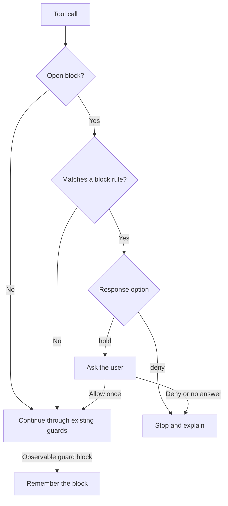

<p align="center"></p>

<p align="center">
  
  
  <a href="LICENSE"></a>
  
</p>

<p align="center"><strong>Arrester remembers your guards' blocks and stops common detours to the same target.</strong></p>
<p align="center"><a href="#why">Why</a> · <a href="#features">Features</a> · <a href="#how-it-works">How it works</a> · <a href="#install">Install</a> · <a href="#commands">Commands</a> · <a href="#options">Options</a> · <a href="#known-limits">Known limits</a></p>

> Vendored from [dot-agi/arrester](https://github.com/dot-agi/arrester) (MIT, by dot-agi). Install with `npx claude-code-templates@latest --mod security/arrester`, or from the author's marketplace as described below. Installed with `--mod`, it loads as `arrester@skills-dir`: set its options in `/config`, or under `pluginConfigs["arrester@skills-dir"].options` in `~/.claude/settings.json`. Report issues upstream.


A deny rule blocks cat. Arrester stops the head detour.

## Why

A guard can block one tool call while a different tool still reaches the same file, as reported in [Claude Code issue #29709](https://github.com/anthropics/claude-code/issues/29709).
Arrester remembers supported blocks from a settings hook, a deny rule, auto mode, or your own “No” in the permission dialog, within the [capture limits](#known-limits), and checks later calls against them.
A safe alternative that matches none of Arrester's rules goes on to your guards. A recognized detour to the blocked target stops.

## Features

- **Follows the guards you have.** Uses the blocks of your existing hooks, deny rules, and auto mode, so you write no new rules.
- **Matches across tools.** Recognizes common shell rewrites and file-tool calls that reach a blocked path.
- **Protects your guards.** While a block from a hook, rule, or classifier is open, stops recognized reads or changes of guard files, and `claude` commands that can turn guards off.
- **Checks subagents.** Applies the same rules to tool calls from subagents in the conversation.
- **Explains each stop.** Tells Claude which block the call matched and why. `/arrester` shows the open blocks and the recent decisions.
- **Denies or asks.** Refuses a match at once, or holds it until you answer.

## How it works



- **Capture:** Arrester records the blocked call's paths, the access to each (read, write, or delete), and the shape of its command. When the deny reason names some of the paths but not all, and each word in it that looks like a path names one of them, Arrester records only the named paths. A command that changes its folder with `cd`, `pushd`, or `popd` keeps every path.
- **Match:** A later call matches when it reaches a blocked target, repeats the blocked command with changed flags or argument order, reads or changes a guard, or is opaque: it runs code or names paths that Arrester cannot read. A retry that only drops flags skips the retry rule; the other rules and your guards still apply.
- **Guards:** The guard files are your user and project settings files, the hook scripts that your settings name by an absolute path or by a [supported relative path](#known-limits), Arrester's own folder, and your installed plugins (changes only). A nested `claude` command with `--settings`, `--bare`, `--safe-mode`, `--dangerously-skip-permissions`, `--allow-dangerously-skip-permissions`, or `--permission-mode bypassPermissions` also counts, and so do `claude plugin disable`, `claude plugin uninstall`, and `claude plugin configure … --values-stdin`, also as `claude plugins`. Any other nested `claude` run counts too, except a version, help, or tool command; see [Known limits](#known-limits).
- **Your “No”:** Arrester stops only an exact retry of the call you rejected, so a changed request can go on. The target, guard, and opaque rules do not apply to it.
- **Lifetime:** A block closes after `block_minutes` (see [Options](#options)), or when you run `/arrester clear`. `/clear`, `/resume`, and `/branch` start a fresh record.
- **No open block:** Arrester passes calls through without analyzing them.

See the [usage guide](https://github.com/dot-agi/arrester/blob/main/docs/usage.md#how-a-later-call-is-checked) for access rules, supported shell forms, and script handling.

## Install

Works with Claude Code 2.1.296 and later. Tested with Claude Code 2.1.296.

Inside Claude Code:

```text
/plugin marketplace add dot-agi/arrester
/plugin install arrester@arrester
```

From a shell:

```sh
claude plugin marketplace add dot-agi/arrester
claude plugin install arrester@arrester
```

To try it for one session from a clone:

```sh
git clone https://github.com/dot-agi/arrester
claude --plugin-dir ./arrester
```

### Agents and scripts

Install from a shell. The part after the install turns on auto-update. It runs only when the install succeeds and the marketplace entry exists:

```sh
claude plugin install arrester --marketplace dot-agi/arrester --scope user --json \
  && f="${CLAUDE_CONFIG_DIR:-$HOME/.claude}/settings.json" \
  && jq -e --arg name arrester '.extraKnownMarketplaces[$name].source' "$f" > /dev/null \
  && tmp=$(mktemp "$f.XXXXXX") \
  && { jq --arg name arrester '.extraKnownMarketplaces[$name].autoUpdate = true' "$f" > "$tmp" && mv "$tmp" "$f" || { rm -f "$tmp"; false; }; }
```

Auto-update runs only in interactive sessions. A headless job updates at its start, before the session that uses the mod:

```sh
claude plugin update arrester@arrester --json
```

Check the result. The first command prints the installed version. The second prints the latest release:

```sh
claude plugin list --json | jq -r '.[] | select(.id == "arrester@arrester") | "\(.version) enabled=\(.enabled)"' \
  && git ls-remote --tags --refs https://github.com/dot-agi/arrester 'arrester--v*' | sed 's/.*--v//' | sort -V | tail -n 1
```

- New code loads in the next session, or after `/reload-plugins`.
- Running `install` again does not update. Use `update`.
- On a host with no SSH key for GitHub, set `CLAUDE_CODE_PLUGIN_PREFER_HTTPS=1` in the environment of every `claude` command and session.
- The `mv` replaces the settings file, with mode 600. If `settings.json` is a symbolic link, edit its target instead.

## Commands

| Command | What it does |
| --- | --- |
| `/arrester` or `/arrester status` | Shows the open blocks, the held calls, and the last ten decisions. |
| `/arrester history [1-5]` | Shows ten retained decisions per page, newest page first, with clipped detail. |
| `/arrester clear` | Closes every open block. |
| `/arrester clear b2` | Closes block b2. |

Only you can run `clear`. Arrester accepts it from your own prompt, from Remote Control, and from an SDK host: the desktop app, the VS Code panel, `claude -p`, or a program of your own on the Agent SDK. It refuses `clear` from every other origin, such as a scheduled task or another session.


`/arrester status` lists the open block and recent stops.

## Options

Set them in `/config`. From a shell, write the values to a JSON file and run `claude plugin configure arrester@arrester --values-stdin < values.json`. A `--mod` install loads the mod as `arrester@skills-dir`, so use that key in `~/.claude/settings.json` for that install.

| Option | Values | Default | What it does |
| --- | --- | --- | --- |
| `response` | `deny`, `hold` | `deny` | `deny` refuses a match at once and tells Claude to stop and ask you. `hold` asks you first, with `Deny` and `Allow once`; `Allow once` still sends the call through every guard. Where nobody can answer (`claude -p`), `hold` refuses. |
| `block_minutes` | 1 to 1440 | 30 | How long a block stays open after it opened or after its last target or retry match. |

## How it compares

Arrester remembers supported guard blocks within the current conversation. These tools provide complementary checks and controls.

| Tool or feature | What it does | What Arrester adds |
| --- | --- | --- |
| Built-in [`/permissions` Recently denied](https://code.claude.com/docs/en/permission-modes#when-auto-mode-falls-back) and the [`PermissionDenied` hook](https://code.claude.com/docs/en/hooks#permissiondenied) | Lists auto mode denials, which you can retry with your approval; the hook runs on each auto mode denial. | Checks later calls against a recorded block, including recognized routes through other tools. |
| Built-in [protected paths](https://code.claude.com/docs/en/permission-modes#protected-paths) | Never auto-approves writes to protected folders such as `.git` and `.claude`, except in `bypassPermissions` mode and in some sessions where that mode is available. | While a block from a hook, rule, or classifier is open, also stops recognized reads of guard files and recognized guard-changing commands. |
| [Termaxa](https://github.com/termaxa/termaxa) | Applies command policies, previews consequences, and uses a circuit breaker for repeated destructive intent across shells and sessions. | Follows supported blocks from other guards and matches their specific file targets. |
| [melodic-software guardrails](https://github.com/melodic-software/claude-code-plugins/blob/main/plugins/guardrails/README.md) | `block-hook-bypass` checks Bash writes that bypass Write/Edit hooks; other guards check file changes. | Remembers a prior block and checks later calls against its targets across tools. |
| [destructive_command_guard (dcg)](https://github.com/Dicklesworthstone/destructive_command_guard) | Uses rule packs to block destructive commands, with explanations and allow-once controls. | Follows observable hook blocks and stops common attempts to reach the blocked target another way. |
| [guard-and-guide](https://github.com/kawarimidoll/guard-and-guide) | Uses configurable regular-expression rules to deny commands and suggest safer alternatives. | Checks whether a later alternative matches an open block's target or another block rule. |

## Known limits

### What it catches

- A blocked file or folder reached another way, such as `head` after a blocked `cat`, the Read tool, an MCP call that names the path, or a search with a file filter or a depth limit that names it or a folder that holds it.
- Files inside a folder after a blocked search of that folder by grep, rg, ag, ugrep, or the Grep tool, with no file filter, depth limit, or file listing, such as `cat secrets/token.txt` after a blocked `grep -r . secrets`.
- Commands inside shell scripts, and literal paths in common file operations of interpreter code, such as `python -c`. A shell that starts with a printing option and runs a script file, such as `bash -v check.sh`, also reads the script.
- While a block from a hook, rule, or classifier is open: reads and changes of settings and hook files, and nested `claude` runs.

### What it does not catch

- Paths that code builds at run time, in scripts, interpreter code, or command output, and code that Arrester does not read: functions and aliases from your shell profile, unlisted runners such as `bundle exec`, compiled programs, and remote commands. Arrester reads printing options only on the command line of a shell that runs a script file. So it records no read of a script printed after `set -x` or `bash -x -c`, or through options from the environment or a `#!` line, as in `set -x; . check.sh` or `SHELLOPTS=xtrace bash check.sh`.
- Reads inside a folder after a blocked call that records no folder: a search with a file filter, a depth limit, or a file listing, such as `rg -t py KEY src` or `rg --files src`; a recursive copy, sync, archive, or compare, such as `cp -r src /tmp` or `rsync -a src /tmp`; a search of a broad folder, such as the project folder; or a search whose deny reason suggests another tool. A search with a file filter or a depth limit that names no folder, such as `rg -t py KEY`, counts as no read.
- Copies into a folder from a glob, `find`, or `xargs`, such as `cp /staging/* /work/`, that replace a blocked file.
- Hook denials in managed settings, a changed retry after your own “No”, which stops only the same call, and a path of a blocked call that the deny reason does not name, when the reason names another path of the call, such as `config/app.yaml` after a hook denied `cat config/secrets.env config/app.yaml` for `config/secrets.env`. The guard still checks that path.

Arrester is not a sandbox and cannot recognize every shell rewrite. The [full list of known limits](https://github.com/dot-agi/arrester/blob/main/docs/usage.md#known-limits) gives each limit with examples and workarounds.

<details>
<summary>Read the limits that you are most likely to hit</summary>

Most of these limits apply while a block from a hook, deny rule, or auto mode classifier is open. In hold mode, `Allow once` still runs every guard. In deny mode, inspect the call and its block with `/arrester`; clear that specific block only if you intend to end its protection.

- **Searches that name no folder:** A search with no folder, such as `rg pattern`, `grep -r pattern`, or a Grep call without `path`, counts as a read of the session's folder. For rg and ag, Arrester skips hidden names there, as they do, unless a flag such as `--hidden` shows them. A search with a file filter, such as `rg -g '*.ts' pattern`, `rg -t py pattern`, `grep -r --include='*.ts' pattern`, `ag -G '\.ts$' pattern`, or `ag --js pattern`, counts as no read, so it can read a blocked file without a stop or a warning. A search with a depth limit, such as `rg --max-depth 1 pattern`, `ag --depth 1 pattern`, or `ugrep -r --depth=2 pattern`, also counts as no read, so it can read a blocked file within that depth without a stop or a warning. Some other reads also pass without a stop or a warning: hidden files that a ripgrep config file or an rg flag that Arrester does not read shows, and a search by a subagent that runs in its own folder. An rg or ag search can also stop falsely on a hidden file below a visible folder, such as `apps/.env`, or on a file that `.gitignore` hides. A Grep or Glob call gets no target stop from a block of a `Read(` deny rule, because Claude Code leaves those files out of its search. Ask Claude to name the search folder while a read block is open.
- **Copies into a folder:** For a copy, move, or link into a folder, such as `cp /work/staging/secret /work/`, Arrester records the entry that it makes there, `/work/secret`. It cannot name that entry when the source's last name is a glob, as in `cp /staging/* /work/`, when the source comes from `find -exec` or from unknown `xargs` input, or for an rsync source that ends in `/`. Such a copy can replace a file under a write or deletion block without a stop or a warning. Under a deletion block, a recursive copy of a folder, such as `cp -r /staging/d /work/` with `/work/d/secret` blocked, also passes. Arrester records the entry also when the destination is a file, which can cause a false stop. A copy, move, or link that cannot replace an entry or changes nothing adds no entry: `cp -n`, `mv -n`, `--update=none`, `rsync -n`, `rsync --ignore-existing`, and `ln` without a flag that replaces, such as `-f`. Such a call can still make a blocked file that does not exist yet without a stop or a warning. A call that gives `-n` together with `-i` or `-f`, such as `cp -i -n`, still adds the entry, so it can stop falsely. A copy of 128 or more named files into one folder passes the limit of 256 path effects, so it is opaque. Ask Claude to name the destination file, and check globbed or found copies into the folder of a protected file yourself.
- A blocked search of a file or a folder by grep, egrep, fgrep, ugrep, rg, or ag, such as `grep -r KEY /work/secrets`, or a Grep call with that `path`, records it, so a later read of it, or of a file inside the folder, stops. A blocked search with a file filter or a depth limit records no folder, such as `grep -r --include='*.ts' KEY /work/src`, `rg -g '*.ts' KEY /work/src`, `rg --max-depth 1 KEY /work/src`, `rg --ignore-file .ignore KEY /work/src`, or a Grep call with `glob` or `type`. A blocked search with `--files`, `--type-list`, `--help`, or `--version`, such as `rg --files /work/src`, lists files or prints something else, so it records no folder either. A blocked recursive copy, sync, archive, or compare of a folder records no folder, such as `cp -r /work/secrets /tmp/s`, `rsync -a --exclude='*.env' /work/src/ /tmp/b/`, `tar -czf /tmp/s.tgz /work/secrets`, or `diff -r /work/a /work/b`. Reads inside such a folder pass without a stop or a warning, also of files that the blocked call would have read. Such a call on a regular file still records the file. A later search with a file filter or a depth limit still stops when it names a recorded file or folder, or a folder that holds one. The [full list of known limits](https://github.com/dot-agi/arrester/blob/main/docs/usage.md#known-limits) names each filter and depth flag. A blocked search records no folder that is `/`, the home folder, the session's folder, or the project folder, that holds one of them, or that holds a settings or hook file, so reads inside such a folder pass without a stop or a warning. A search that names no folder reads the session's folder, so it records none. A blocked search also records no folder when the deny reason suggests another tool: it says `instead`, `prefer`, `please use`, `use rg`, or `` try ` `` in any letter case, such as `Use rg instead of grep`. Then the suggested search of the folder, and reads inside it, pass without a stop or a warning, also when the reason says that the folder holds secrets too. A blocked recursive search of a glob path, such as `rg KEY /work/config/*.env`, and a blocked recursive listing, such as `ls -R` or a Glob call, record no target. A blocked listing or search that is not recursive records its path, also a glob path: after a blocked `ls /work/secrets` or `grep KEY /work/config/*.env`, a later read of `/work/secrets/token.txt` or `/work/config/secret.env` stops. A later search that holds a recorded folder reads it too, so it stops, such as `rg KEY` in the project. When a hook denies a search of a file only to suggest another tool, such as `rg` for `grep`, that tool's search of the same file stops too.
- Arrester reads paths from Bash, Monitor, Read, Write, Edit, NotebookEdit, LSP, Grep, Glob, SendFile, and SendUserFile calls, from a `file:` URI in a ReadMcpResourceTool call, and from MCP calls. An MCP call names a path only with a whole one-line string that is absolute, starts with `~/`, or is a local `file:` URI. Arrester cannot know what the MCP tool does with it, so an MCP call that only reads a write-blocked or deletion-blocked file stops too. A named folder that exists matches no write or deletion block. An MCP call that changes or deletes a folder under a write or deletion block, a file inside such a folder, or a folder that holds a blocked file passes without a stop or a warning, and so do relative paths, paths inside longer text, and calls of other tools. An MCP call that names more than 256 paths is opaque.
- Your “No” matches only an identical call: the same command text, working folder, and relevant tool arguments. A command that differs by one character goes on to your guards. Tool input past the serialization limits gets no exact identity, so your “No” on such a call matches no retry.
- Managed-settings hook denials end before installed mods run, so Arrester cannot observe them. With managed settings on the machine, or with a Team or Enterprise sign-in, Arrester sees a hook that denies with JSON only through the permission verdict, which names the hook. There, a deny that Claude Code makes after a hook's answer can also open a hook block: the tool's own check or a safety check that denies after a hook's ask, or a hook's changed input that Claude Code refuses.
- Arrester expands `~`, `$HOME`, and `$CLAUDE_PROJECT_DIR` in a hook command; a hook with `args` gets only `$CLAUDE_PROJECT_DIR`. A relative hook path counts only as a command's program, such as `./hooks/check.sh`, as the first path after an interpreter or a shell, such as `python3 .claude/hooks/guard.py`, or under `.claude/`. Arrester reads it in the session's folder and in the project folder when the block opens. A bare name such as `python3 guard.py` and a script found through `PATH` add no guard. A `cd` in the hook command does not count, so the path after it guards the wrong file or none. Write `python3 "$CLAUDE_PROJECT_DIR"/hooks/guard.py` to guard such a file.
- In an interpreter script that last changed before the oldest open block, Arrester counts only a literal path that is a whole argument of a definite file operation, such as `shutil.rmtree('/w/d')`. Paths that such a script passes to `subprocess`, `exec`, `spawn`, `system`, or `popen`, builds from parts, nests in another call, or keeps in a `Path(…)` that no file operation uses directly, such as `p = Path('/w/d')` before `p.read_text()`, pass without a stop or a warning. So does the whole script when the call has no work budget left for it. In an older shell script, code that Arrester cannot read does not count, including code past the command-length or nesting limit. At capture, every script read from disk counts as older, and an older interpreter script is not scanned, so a block on an interpreter script on disk records no targets from inside it.
- A nested `claude` run does not inherit the open blocks, so while a block from a hook, rule, or classifier is open, it stops: also as `claude-code`, in any letter case, by a `claude/versions/<version>` path, or through a runner such as `npx`. Only a first word of `-v`, `--version`, `-h`, `--help`, or a tool subcommand (`mcp`, `plugin`, `plugins`, `doctor`, `update`, `upgrade`, `install`, `auth`, or `setup-token`) passes, but not `mcp serve`, an `mcp add` form, or a first word or subcommand that does not resolve. So `claude -p "summarize"` and `claude --verbose mcp list` stop too; in hold mode, choose `Allow once`. A session that another program starts still escapes: the Agent SDK, `bun x`, `setsid`, `arch`, Python `subprocess`, another agent CLI, a function or an alias from your shell profile, or a copy of the program under another name.
- Interpreter code can compute paths, use bare file names or names with spaces, or hide literals behind template expressions or comments that the scan reads as code. The scan recognizes common file operations but does not interpret functions or computed values. Some functions imported under a bare name are not recognized, such as `copy` after `from shutil import copy`. The scan skips Python `#` comments in code that python runs, and JavaScript `//` and `/* */` comments in code that node, bun, or deno runs; a script run directly takes its language from its `#!` line. A comment counts only when it starts a line, after any indentation, and a `/*` only when its `*/` follows. Other comments are read as code, such as Ruby, Perl, and PHP comments, a comment after code on the same line, such as the `# note` in `x = 1  # note`, and a `/*` without its `*/`. A file call in them can cause a false stop, and a quote in them can hide the calls after it. In a chain of methods on `Path(…)`, Arrester stops following the chain at a subscript such as `[0]`, at grouping parentheses, or at a parenthesis inside a string argument. A path after that point can take the write or deletion of the call around it, so while a block is open a call such as `os.remove(Path('/w/d').read_text().split()[0].strip('/w/e'))` can stop although it does not touch `/w/e`.
- Arrester walks a function's body at each call, with the call's arguments, and an alias's text at each use, when the same command defines them, and it still checks the call as written. It does not walk a function whose body names `return` or `exit` anywhere, so what that body does passes without a stop or a warning. A folder change or an assignment in them does not reach the commands after the call. Functions and aliases from your shell profile, unlisted runners, such as `bun x`, `npm x`, `yarn exec`, `conda run`, or `bundle exec`, and unlisted program options can escape detection. A function body also counts where the shell would not call it, such as after `env`, `sudo`, or `xargs`, and an alias text where the shell would not expand it, such as later on the same line in Bash or after `unalias`. This can cause a false stop.
- Compiled programs, remote commands, network targets, and Windows paths are outside detection.

</details>

## Privacy

Arrester never approves a tool call and never changes its input. It only denies a call or asks you about it. Every other call goes on, unchanged, to your other guards and the permission check.

- **Network, models, and processes:** Arrester makes no network request, calls no model, and runs no process.
- **Storage:** Its record lives in the session's memory. It writes no file.
- **What it reads:** While a block is open, or when a guard blocks a call, Arrester reads the kind, size, change time, and real path of each path that the call names, the text of a script that the call runs (up to 256 KiB), and the `HOME` variable, to expand `~`. When a guard blocks a call, it also reads your settings through Claude Code's settings API, to find the hook files that they name. It reads no file at other times.
- **Interpreter code:** Arrester reads code that a call gives an interpreter, such as `python -c` or `node -e`, as text, to find the paths that it names. It never runs that code.
- **What Claude sees:** When a guard blocks a call that runs a script, paths and commands from that script can appear in the block's record. `/arrester` and the deny reasons show that record to Claude.
- **Read deny rules:** Arrester reads scripts through the mod file API, which your Read deny rules do not cover.

## Troubleshooting

<details>
<summary>Diagnostics, missing blocks, and hold dialogs</summary>

- Run `claude --debug` and search the debug log for `arrester:`. Each diagnostic names the mod, the event, and the cause.
- A refusal that says "could not check this call against its open blocks" means that Arrester failed while blocks were open, or could not tell whether any were open. It refuses rather than guess. Run `/arrester clear` to close the blocks.
- If no block opens after a hook denies a call, check whether the hook is in managed settings. A hook in managed settings never opens a block. See [Known limits](#known-limits).
- The status line may not show in the desktop app or in VS Code. `/arrester` works on every surface.
- Do not change Arrester's options while a hold dialog is open. The change reloads the mod, Claude Code decides what happens to the held call, and the transcript says that the hold ended.

See [docs/usage.md](https://github.com/dot-agi/arrester/blob/main/docs/usage.md) for the full guide.

</details>

## License

MIT. See [LICENSE](LICENSE).
