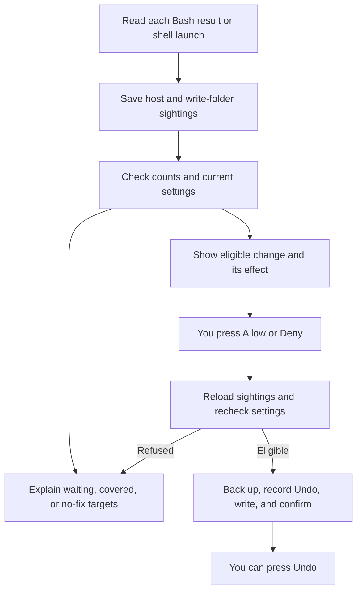

<p align="center"></p>

<p align="center">
  
  
  
  
</p>

<p align="center"><strong>Sandbox Tuner turns recurring Claude Code sandbox blocks into reviewed, undoable settings edits across sessions.</strong></p>
<p align="center"><a href="#why">Why</a> · <a href="#features">Features</a> · <a href="#how-it-works">How it works</a> · <a href="#install">Install</a> · <a href="#commands">Commands</a> · <a href="#known-limits">Known limits</a> · <a href="#privacy">Privacy</a></p>

> Vendored from [dot-agi/sandbox-tuner](https://github.com/dot-agi/sandbox-tuner) (MIT, by dot-agi). Install with `npx claude-code-templates@latest --mod security/sandbox-tuner`, or from the author's marketplace as described below. Installed with `--mod`, it loads as `sandbox-tuner@skills-dir`: set its options in `/config`, or under `pluginConfigs["sandbox-tuner@skills-dir"].options` in `~/.claude/settings.json`. Report issues upstream.


After a repeated network block, the band explains it and offers Allow.

## Why

Sandbox blocks can look like broken networking or file permissions, and the same targets can fail again next session.
Sandbox Tuner handles sandbox blocks, not permission prompts: it explains the blocks that it recognizes, within the [known limits](#known-limits), and counts the hosts and write folders that recur across sessions.
Claude Code's sandbox applies to Bash commands and does not cover Write or WebFetch tool calls ([issue #89762](https://github.com/anthropics/claude-code/issues/89762)).
So Sandbox Tuner reads Bash results, and the hosts that background Bash commands and shell Monitor launches list when they start.

## Features

- **An explanation above the prompt.** The band names the blocked target, the command, and the reason, in the terminal and the desktop app.
- **A ranking across sessions.** `/sandbox-tuner` lists hosts and write folders, with ready fixes first. Hide the targets that you do not want to see, except a target that your settings already allow.
- **A change you review.** Allow shows the exact entry and its effect before you press it. Deny appears for a host that you refused at the network prompt, unless an allowlist lock applies.
- **Undo and a backup.** Each settings edit gets an Undo record. A backup keeps the settings file as it was before the latest write.
- **Narrow fixes.** Folder grants go only to eligible cache and temp folders. Sandbox Tuner offers no wildcard hosts and no command exclusions.


`/sandbox-tuner` ranks blocked hosts: a ready fix first, then waiting ones.


Some blocks have no safe setting. Sandbox Tuner says so.

## How it works



- A **sighting** is a reported block, a host that Claude lists in a command's `allowed_domains`, or a path taken from a permission error. Allow appears after `minimumSightings` sightings (3 by default). The threshold filters noise. It is not a security check.
- Each press of Allow, Deny, or Undo changes one entry in `sandbox.network.allowedDomains`, `sandbox.network.deniedDomains`, or `sandbox.filesystem.allowWrite` of your user settings file: `~/.claude/settings.json`, or `$CLAUDE_CONFIG_DIR/settings.json`.
- Grants apply to every project. An allowed host can receive data on any port. Programs outside the sandbox may later load files written into an allowed folder.
- Each grant respects managed settings, and is checked against the loaded settings and a fresh read of the file. Folder checks follow symbolic links and refuse protected paths, credentials, system folders, and folders on `PATH`.
- Before a write, the previous file goes to `backups/settings.json.sandbox-tuner.bak` in the config folder. Sandbox Tuner then checks that nothing else changed the file, writes it as 2-space JSON, reads it back, and checks it again two seconds later.
- Undo removes only the entry that its press added. While a removal is unconfirmed, its row in the Applied list keeps **Retry Undo**. The [usage guide](https://github.com/dot-agi/sandbox-tuner/blob/main/docs/usage.md) has the full rules and the recovery steps.

## Install

Requires Claude Code 2.1.288 or later, with the sandbox turned on through `/sandbox`, on macOS, Linux, or WSL2. Tested with Claude Code 2.1.296.

Inside Claude Code:

```text
/plugin marketplace add dot-agi/sandbox-tuner
/plugin install sandbox-tuner@sandbox-tuner
```

From a shell:

```bash
claude plugin marketplace add dot-agi/sandbox-tuner
claude plugin install sandbox-tuner@sandbox-tuner
```

To try it for one session from a clone:

```bash
claude --plugin-dir ./sandbox-tuner
```

## Commands

| Command | What it does |
| --- | --- |
| `/sandbox-tuner` | Opens the pane and loads the sightings that other sessions saved. Prints the text report when the app cannot place the pane. |
| `claude -p "/sandbox-tuner"` | Prints the ranking as text. Never writes settings. |

The band's buttons have no hotkeys. Click one, or press Ctrl+X, then Tab, to focus the band, then Tab to the button and Enter.
Ctrl+X, then Tab is Claude Code's own focus chord. Release Ctrl before Tab: many terminals read Ctrl+Tab as next tab.
In Emacs terminals, click the band's button, or rebind `abovePrompt:focus` with [`/keybindings`](https://code.claude.com/docs/en/keybindings#above-prompt-actions).
In the pane, Tab moves between buttons, Enter presses one, the arrow keys scroll, and Esc closes it.

## Options

| Option | Default | Range | Meaning |
| --- | --- | --- | --- |
| `minimumSightings` | 3 | 1–100 | How many times a host or write folder must recur before Sandbox Tuner offers Allow. Refusals at the network prompt stay in the counts but do not count toward it. |

Set it with `/plugin configure sandbox-tuner@sandbox-tuner`, or in `/config`. A `--mod` install loads the mod as `sandbox-tuner@skills-dir`, so use that key in `~/.claude/settings.json` for that install.

## How it compares

| Feature or project | What it does | What Sandbox Tuner adds |
| --- | --- | --- |
| Built-in [`/sandbox`](https://code.claude.com/docs/en/sandboxing) | Configures Claude Code's sandbox and its operating mode. | Explanations for observed blocks, counts across sessions, and reviewed edits with Undo. |
| Built-in [network prompt approvals](https://github.com/anthropics/claude-code/pull/71627) | Approves hosts for the current session. | Persistent user-settings entries after you review a recurring target. Prompt approvals themselves are not counted. |
| Bash [`allowed_domains`](https://code.claude.com/docs/en/sandboxing#per-command-allowed-domains-in-auto-mode) | Lets a command declare needed hosts in auto mode, subject to network policy. Saves no lasting grant. | Counts those declarations across sessions and offers an eligible persistent setting after the threshold. |
| [ktrysmt's sandbox auto-allow hook](https://ktrysmt.github.io/blog/claude-code-sandbox-network-auto-allow/) | Automatically extracts hosts from many error patterns and appends them to `allowedDomains`; uses a lock for settings writes. | Review before each grant, Undo, a backup, recurring-target counts, and guarded cache/temp folder fixes. |

## Known limits

The folder link check has blind spots, a failed command can forge a sandbox report, some blocks get no fix, sessions that edit settings at once can clash, and Undo, Hide, counts, saved data, and the settings file have limits.

<details>
<summary>Read all known limits</summary>

- **The link check before a folder Allow has blind spots.** Before a folder Allow, Sandbox Tuner follows each link that it finds in the guarded folders. In Claude Code's config folder (`~/.claude`), it reads only where code or settings that run outside the sandbox live: the top level, `hooks`, `commands`, `agents`, `skills`, `output-styles`, `workflows`, the plugins, and `local`. It skips the data folders, such as transcripts (`projects`), `todos`, `shell-snapshots`, `logs`, `debug`, `statsig`, `cache`, `backups`, and `file-history`, and the `.git` folder of each plugin marketplace. It reads only the top two levels of each installed plugin, plugin marketplace, and plugin data folder, of `local`, and of each VS Code extension in `~/.vscode/extensions`. A link in a skipped folder, or deeper in a plugin, in `local`, or in an extension, does not stop a folder Allow. Neither does a hard link, or a link made after the check. At the start of each interactive session, also after `/clear`, `/resume`, or `/branch`, while a folder that Allow opened is still in your settings file, Sandbox Tuner walks the same guarded folders again. A toast then names each link, guarded folder, or `PATH` folder that leads into such a folder, or to a folder that holds it, and names each such folder. Like Allow, it ignores letter case, so it can also warn about a folder whose name differs only in case. It warns and does not take the grant back. It skips the same folders, finds no hard link, and sees a link made during a session only at the next session start. With `claude --resume`, the same toast can show twice when saved data loads slowly. Read the change before you press.
- **A large guarded folder makes folder Allow refuse.** Sandbox Tuner walks the protected places and the credentials folders in two walks. Each walk reads at most 1,000 folders and 25,000 entries. A walk that needs to read more, or cannot read a folder, refuses the grant. A large `skills` folder, a credentials folder with many files, or very many installed plugins and VS Code extensions can cause `guarded directory traversal limit exceeded`. If you trust the folder, add it to `sandbox.filesystem.allowWrite` in your user settings file by hand.
- **Wildcard rules and rules with no known anchor make Sandbox Tuner cautious.** It counts an `Edit(<folder>/**)` allow rule as cover only when the folder has no wildcard. So it can offer Allow for a folder that a wildcard Edit rule already opens. A deny rule with a wildcard, in `permissions.deny` or in `sandbox.filesystem`, withholds Allow for every folder under the folder that holds its first wildcard. For example, `Read(~/**/*.key)` withholds Allow for every folder in your home folder. In command-line or managed settings, a rule path that starts with a single `/`, and a relative `sandbox.filesystem` entry, have no known anchor. Such an Edit allow rule or `allowWrite` entry counts as no cover. Such a deny rule or `denyWrite` or `denyRead` entry withholds Allow for every folder.
- **Paths from error text can be wrong.** When no sandbox report names a file, Sandbox Tuner takes the path from a permission error such as `Operation not permitted`. Punctuation in the error can cut the path short. A relative path counts from the session working directory, which can differ from the folder where the command ran. The error can also come from a blocked read. So a folder with any such sighting never gets Allow, even when sandbox reports name it too. Its counts and explanation remain.
- **A failed command can forge a sandbox report.** Claude Code adds the sandbox report of a failed command at the end of the command's output, and can add a proxy note after it. So Sandbox Tuner reads only the `<sandbox_violations>` block that ends that output, before any proxy note. It skips a block that other output follows, and writes a debug line. But a command that prints a block as its last output, for example from a file, and then fails, still forges a report: Sandbox Tuner counts that block as a block. Such a block counts only while the sandbox is on, and not when the command ran outside the sandbox at Claude's request. A Claude Code version that adds other text after its report makes Sandbox Tuner skip the real report too, with the same debug line. Before you press Allow, check that you expect the host or folder. Also check the command that the band names, or the programs that the pane lists.
- **Read, Mach lookup, and socket blocks get no fix.** When a sandbox report names such an operation, the band explains it for the current session only. Sandbox Tuner saves no count for it and offers no Allow. For an operation that it does not know, the band says that it cannot classify it.
- **Later background output goes unseen.** For a background Bash command or a shell Monitor launch, Sandbox Tuner counts the hosts that the launch declared, once, when it starts. It does not read the later output, so blocks there give no sighting.
- **A tool that ignores the sandbox proxy can still fail for an allowed host.** Covered rows in the band, the pane, and the report suggest checking the tool's proxy settings and supported protocols. Sandbox Tuner offers no command exclusion.
- **A target that your settings already allow cannot be hidden.** While your settings allow it, its row in the pane has no Hide, and it stays at the end of its list. A target that you hid before your settings allowed it stays in the Hidden list, with Unhide.
- **Two sessions that edit settings at the same moment can clash.** Claude Code offers no way to lock a file, so presses in two sessions at the same moment can take one change back. Sandbox Tuner tells you two seconds later. Another program that saves the file at the same moment can lose its own change, and Sandbox Tuner cannot see that. If two sessions add the same entry with the same recorded time, both Undo buttons can refuse with "a later journal entry owns this setting". Then remove the unwanted entry from your user settings file by hand. Use one settings-editing session at a time.
- **An unfinished addition can claim an entry that you add by hand.** A press that stops after it saved its Undo record, for example with "could not write" or "could not save the Undo journal", can leave the change marked "addition unconfirmed" in the Applied list. If you then add the same entry by hand, Sandbox Tuner takes it for its own change, and its Undo removes your entry. To keep a manual entry, do not press that Undo.
- **A settings file over 4 MiB cannot be edited.** Claude Code refuses a mod's read or write of a file over 4 MiB. So Allow, Deny, and Undo fail with "could not read" when your user settings file is larger. Sandbox Tuner saves the file in 2-space JSON, and that can make a compact file grow past 4 MiB: a compact file of 3.1 MiB can grow to 4.3 MiB. Then the press fails with "could not write". Edit such a file by hand.
- **A relative `CLAUDE_CONFIG_DIR` moves with the session.** Sandbox Tuner takes it from the session's project root: the folder where the session started, or where `/cd` or a worktree move took it. After such a move, Allow and Deny edit a different `settings.json`. The pane names the file after "Settings file:". Set `CLAUDE_CONFIG_DIR` to an absolute path.
- **Undo reaches only the 50 newest changes.** The Applied list keeps the 50 newest changes, plus each change whose addition or removal is unconfirmed. An older change has no Undo. To take it back, remove its entry from your user settings file by hand.
- **The saved data only grows.** Each session saves its own sightings, and Sandbox Tuner deletes no saved sighting and no Undo record of a written change. Near Claude Code's 4 MiB store limit, saves fail with a `sandbox-tuner:` problem, and Allow, Deny, and Undo can refuse to write. After a failed sighting save, Allow and Deny refuse for the rest of that session. To start over, quit Claude Code and delete Sandbox Tuner's file in `$CLAUDE_CONFIG_DIR/plugins/store/`, or in `~/.claude/plugins/store/` when `CLAUDE_CONFIG_DIR` is unset. The file name starts with `sandbox-tuner`. This also deletes its Undo records.
- **Counts are a guide, and some counts and lists are capped.** Claude Code does not document whether saves from two sessions at the same moment both last, so a count can fall short. The pane and the report show only the newest 300 targets seen within 30 days. The Hosts, Write folders, and Hidden lists of the pane, and each section of the report, show at most 25 targets. One call counts at most three write folders, and a further write folder in that call gets no count and no explanation. Sandbox Tuner reads only the last 200,000 characters of the output and of the error output of a call. A target keeps at most five ports, and checks against port-specific settings entries use only those ports. A target keeps at most 20 session ids and three program names. So the band, the pane, and the report count at most 20 sessions, and the pane and the report name at most three programs.

</details>

## Privacy

Sandbox Tuner makes no network request and starts no process. Nothing leaves your machine.

- **Hooks.** Sandbox Tuner reads each Bash call and each shell Monitor launch after Claude Code has handled it. It changes no tool call and no tool result, adds no instructions for Claude, and hooks no permission event. If a hook fails, it writes a `sandbox-tuner:` line to the debug log. The pane and the command then show the error, and every other hook passes its event on unchanged. Every hook is in `hooks/register.tsx`.
- **Reads.** The command, its listed hosts, and its output and error output, only to find sandbox blocks. Your settings from every source (user, project, local, command line, and managed), and the text of your user settings file. The variables `HOME`, `CLAUDE_CONFIG_DIR`, and `PATH`, the working directory, the project root, and the session id. When you press Allow on a write folder, it also finds where that folder, your home folder, the config folder, the working directory, the protected places, the credentials folders (such as `~/.ssh`), and each `PATH` folder really lie. At the start of an interactive session, also after `/clear`, `/resume`, or `/branch`, while a folder that Allow opened is still in your settings file, it finds where that folder, the protected places, the credentials folders, and each `PATH` folder lie. This check lists names and follows links. It opens no file. [What a write changes](https://github.com/dot-agi/sandbox-tuner/blob/main/docs/usage.md#what-a-write-changes) has the full list.
- **Writes.** Sandbox Tuner writes two files itself, and only when you press Allow, Deny, or Undo: your user settings file and its backup. An edit changes one entry under `sandbox` and keeps every other key. All other data goes to Claude Code's plugin store.
- **The backup.** It is a full copy of your user settings file, which can hold secrets in `env`. It is created with your default file mode, which can be wider than the mode of your settings file. Sandbox Tuner uses no secret, and saves none apart from this copy.
- **The store.** Sandbox Tuner keeps its data in Claude Code's plugin store (`$CLAUDE_CONFIG_DIR/plugins/store/`, or `~/.claude/plugins/store/` when `CLAUDE_CONFIG_DIR` is unset): hosts, ports, folder targets, one denied path for each folder, program names, session ids, counts, times, Hide choices, and the Undo journal (each entry that it added and the file it went into). It saves no command line, no output, and no other settings content.
- **Problems.** A problem that Sandbox Tuner shows or writes to the debug log quotes only `sandbox` and `permissions` entries of your settings. When your settings file is not valid JSON, the problem shows `…` in place of the file text that the JSON parser quotes.

## Troubleshooting

<details>
<summary>Missing bands, unavailable fixes, settings errors, and diagnostics</summary>

- **No band.** The sandbox is off, the session runs in VS Code or the mobile app (no band there), a survey holds the band, you dismissed that block, or you already fixed it. Run `/sandbox-tuner`.
- **No Allow.** The target has not recurred enough, managed settings lock the allowlist, your settings already allow it, the folder is no cache or temp folder, or a rule of yours refuses it. The row says which.
- **"Claude Code has not applied it yet".** Your settings file holds the entry, but the session did not load it. Run `/status` to check that the session loads user settings, and look for a ConfigChange hook that blocks the change.
- **"Your settings already allow it", and the sandbox still blocks it.** The tool may ignore the sandbox proxy, the block may be a read, or file permissions may refuse it. Check the tool's proxy settings and supported protocols. Run `/status` or `/doctor` for managed-settings warnings.
- **"is not valid JSON".** Fix your user settings file (`$CLAUDE_CONFIG_DIR/settings.json`, or `~/.claude/settings.json` when `CLAUDE_CONFIG_DIR` is unset), then press again. Sandbox Tuner never edits a file it cannot parse.
- **"could not confirm that ... is unchanged".** Another session or program saved your settings file during the press. Sandbox Tuner left the file as it is. Press again.
- **"... leads to ...".** The folder is a link, and its real place is no cache or temp folder, or a rule refuses it there. Nothing was written.
- **"guarded directory traversal limit exceeded" after Allow on a folder.** A guarded folder is too large for the link check, so nothing was written. If you trust the folder, add it to `sandbox.filesystem.allowWrite` in your user settings file by hand. See [Known limits](#known-limits).
- **"This folder holds credentials" after Allow on a cache folder.** A link puts a credentials folder inside it, such as `~/.ssh` linked into `~/.cache`. Nothing was written.
- **"... name one place on a file system that ignores letter case".** A guarded folder or a `PATH` folder differs from the folder only in letter case, and on macOS that is the same place. Nothing was written.
- **"... is no longer in ...: another session or program saved the file at the same moment".** Two writes crossed, and the other one took your change back. Press again.
- **A host that you approved at the network prompt has no count.** No event reports those approvals. In auto mode, Claude lists hosts on its commands, so counts grow fastest there.
- **Debug lines.** Run `claude --debug` and look for lines that contain `sandbox-tuner:`. Each names the event and the cause. Sandbox Tuner cuts a line longer than 4,096 characters and ends it with `…`.

The [usage guide](https://github.com/dot-agi/sandbox-tuner/blob/main/docs/usage.md#notices-and-diagnostics) lists every notice and what to do.

</details>

## License

[MIT](LICENSE).
