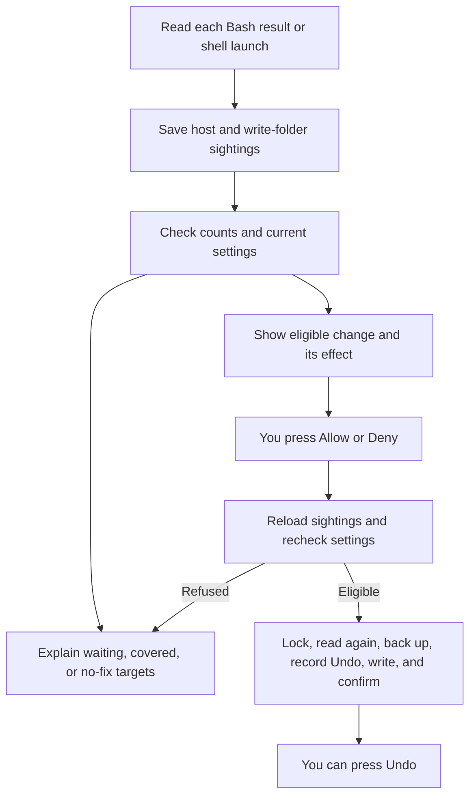

<p align="center"></p>

<p align="center">
  
  
  
  
</p>

<p align="center"><strong>Sandbox Tuner turns recurring Claude Code sandbox blocks into reviewed, undoable settings edits across sessions.</strong></p>
<p align="center"><a href="#why">Why</a> · <a href="#features">Features</a> · <a href="#how-it-works">How it works</a> · <a href="#install">Install</a> · <a href="#commands">Commands</a> · <a href="#known-limits">Known limits</a> · <a href="#privacy">Privacy</a></p>

> Vendored from [dot-agi/sandbox-tuner](https://github.com/dot-agi/sandbox-tuner) (MIT, by dot-agi). Install with `npx claude-code-templates@latest --mod security/sandbox-tuner`, or from the author's marketplace as described below. Installed with `--mod`, it loads as `sandbox-tuner@skills-dir`: set its options in `/config`, or under `pluginConfigs["sandbox-tuner@skills-dir"].options` in `~/.claude/settings.json`. Report issues upstream.


After a repeated network block, the band explains it and offers Allow.

## Why

Sandbox blocks can look like broken networking or file permissions, and the same targets can fail again next session.
Sandbox Tuner handles sandbox blocks, not permission prompts: it explains the blocks that it recognizes, within the [known limits](#known-limits), and counts the hosts and write folders that recur across sessions.
Claude Code's sandbox applies to Bash commands and does not cover Write or WebFetch tool calls ([issue #89762](https://github.com/anthropics/claude-code/issues/89762)).
So Sandbox Tuner reads Bash results, and the hosts that background Bash commands and shell Monitor launches list when they start.

## Features

- **An explanation above the prompt.** The band names the blocked target, the command, and the reason, in the terminal and the desktop app.
- **A ranking across sessions.** `/sandbox-tuner` lists hosts and write folders, with ready fixes first. Hide the targets that you do not want to see, except a target that your settings already allow.
- **A change you review.** Allow shows the exact entry and its effect before you press it. Deny appears for a host that you refused at the network prompt, unless an allowlist lock applies.
- **Undo and a backup.** Each settings edit gets an Undo record. A backup keeps the settings file as it was before the latest write.
- **Narrow fixes.** Folder grants go only to eligible cache and temp folders. Sandbox Tuner offers no wildcard hosts and no command exclusions.


`/sandbox-tuner` ranks blocked hosts: a ready fix first, then waiting ones.


Some blocks have no safe setting. Sandbox Tuner says so.

## How it works



- A **sighting** is a reported block, a host that Claude lists in a command's `allowed_domains`, or a path taken from a permission error. Allow appears after `minimumSightings` sightings (3 by default). The threshold filters noise. It is not a security check.
- Each press of Allow, Deny, or Undo changes one entry in `sandbox.network.allowedDomains`, `sandbox.network.deniedDomains`, or `sandbox.filesystem.allowWrite` of your user settings file: `~/.claude/settings.json`, or `$CLAUDE_CONFIG_DIR/settings.json`.
- Grants apply to every project. An allowed host can receive data on any port. Programs outside the sandbox may later load files written into an allowed folder.
- Each grant respects managed settings, and is checked against the loaded settings and a fresh read of the file. Folder checks follow symbolic links and refuse protected paths, credentials, system folders, and folders on `PATH`.
- Before a write, Sandbox Tuner takes a lock file next to the settings file, so that presses in other sessions wait their turn. Under the lock, it reads the file, the sightings, and the Undo journal again, checks the press again, and applies it to the current text or refuses. Then the previous file goes to `backups/settings.json.sandbox-tuner.bak` in the config folder. Sandbox Tuner checks that nothing else changed the file, writes it as 2-space JSON, reads it back, frees the lock, and checks the file again two seconds later.
- Undo removes only the entry that its press added. While a removal is unconfirmed, its row in the Applied list keeps **Retry Undo**. The [usage guide](https://github.com/dot-agi/sandbox-tuner/blob/main/docs/usage.md) has the full rules and the recovery steps.

## Install

Requires Claude Code 2.1.288 or later, with the sandbox turned on through `/sandbox`, on macOS, Linux, or WSL2. Tested with Claude Code 2.1.296.

Inside Claude Code:

```text
/plugin marketplace add dot-agi/sandbox-tuner
/plugin install sandbox-tuner@sandbox-tuner
```

From a shell:

```bash
claude plugin marketplace add dot-agi/sandbox-tuner
claude plugin install sandbox-tuner@sandbox-tuner
```

To try it for one session from a clone:

```bash
claude --plugin-dir ./sandbox-tuner
```

### Agents and scripts

Install from a shell with Claude Code 2.1.292 or later. The second part turns on auto-update. It runs only when the install succeeds and the marketplace entry exists:

```sh
claude plugin install sandbox-tuner --marketplace dot-agi/sandbox-tuner --scope user --json \
  && f="${CLAUDE_CONFIG_DIR:-$HOME/.claude}/settings.json" \
  && jq -e --arg name sandbox-tuner '.extraKnownMarketplaces[$name].source' "$f" > /dev/null \
  && tmp=$(mktemp "$f.XXXXXX") \
  && { jq --arg name sandbox-tuner '.extraKnownMarketplaces[$name].autoUpdate = true' "$f" > "$tmp" && mv "$tmp" "$f" || { rm -f "$tmp"; false; }; }
```

Claude Code 2.1.288 to 2.1.291 has no `--marketplace` option. Add the marketplace first, then run the auto-update part above:

```sh
claude plugin marketplace add dot-agi/sandbox-tuner --scope user --json \
  && claude plugin install sandbox-tuner@sandbox-tuner --scope user --json
```

Auto-update runs only in interactive sessions. A headless job updates at its start, before the session that uses the mod:

```sh
claude plugin update sandbox-tuner@sandbox-tuner --json
```

Check the result. The first command prints the installed version. The second prints the latest release:

```sh
claude plugin list --json | jq -r '.[] | select(.id == "sandbox-tuner@sandbox-tuner") | "\(.version) enabled=\(.enabled)"' \
  && git ls-remote --tags --refs https://github.com/dot-agi/sandbox-tuner 'sandbox-tuner--v*' | sed 's/.*--v//' | sort -V | tail -n 1
```

- On a host with no SSH key for GitHub, set `CLAUDE_CODE_PLUGIN_PREFER_HTTPS=1` in the environment of every `claude` command and session.
- New code loads in the next session, or after `/reload-plugins`. An agent cannot type `/reload-plugins`, so it starts a new session.
- Running `install` again does not update. Use `update`.
- The `mv` replaces the settings file, with mode 600. If `settings.json` is a symbolic link, edit its target instead.

## Commands

| Command | What it does |
| --- | --- |
| `/sandbox-tuner` | Opens the pane and loads the sightings that other sessions saved. Prints the text report when the app cannot place the pane. |
| `claude -p "/sandbox-tuner"` | Prints the ranking as text. Never writes settings. |

The band's buttons have no hotkeys. Click one, or press Ctrl+X, then Tab, to focus the band, then Tab to the button and Enter.
Ctrl+X, then Tab is Claude Code's own focus chord. Release Ctrl before Tab: many terminals read Ctrl+Tab as next tab.
In Emacs terminals, click the band's button, or rebind `abovePrompt:focus` with [`/keybindings`](https://code.claude.com/docs/en/keybindings#above-prompt-actions).
In the pane, Tab moves between buttons, Enter presses one, the arrow keys scroll, and Esc closes it.

## Options

| Option | Default | Range | Meaning |
| --- | --- | --- | --- |
| `minimumSightings` | 3 | 1–100 | How many times a host or write folder must recur before Sandbox Tuner offers Allow. Refusals at the network prompt stay in the counts but do not count toward it. |
| `linkCheckMinutes` | 15 | 0–1440 | How often, in minutes, an interactive session checks again for links into the folders that Allow opened. 0 turns the timed check off. |

Set them with `/plugin configure sandbox-tuner@sandbox-tuner`, or in `/config`. A `--mod` install loads the mod as `sandbox-tuner@skills-dir`, so use that key in `~/.claude/settings.json` for that install.

## How it compares

| Feature or project | What it does | What Sandbox Tuner adds |
| --- | --- | --- |
| Built-in [`/sandbox`](https://code.claude.com/docs/en/sandboxing) | Configures Claude Code's sandbox and its operating mode. | Explanations for observed blocks, counts across sessions, and reviewed edits with Undo. |
| Built-in [network prompt approvals](https://github.com/anthropics/claude-code/pull/71627) | Approves hosts for the current session. | Persistent user-settings entries after you review a recurring target. Prompt approvals themselves are not counted. |
| Bash [`allowed_domains`](https://code.claude.com/docs/en/sandboxing#per-command-allowed-domains-in-auto-mode) | Lets a command declare needed hosts in auto mode, subject to network policy. Saves no lasting grant. | Counts those declarations across sessions and offers an eligible persistent setting after the threshold. |
| [ktrysmt's sandbox auto-allow hook](https://ktrysmt.github.io/blog/claude-code-sandbox-network-auto-allow/) | Automatically extracts hosts from many error patterns and appends them to `allowedDomains`; uses a lock for settings writes. | Review before each grant, Undo, a backup, recurring-target counts, and guarded cache/temp folder fixes. |

## Known limits

### What it catches

- **Sources.** Network and write blocks in Bash results, and the hosts that Claude lists in `allowed_domains`, across sessions.
- **Fixes.** The band explains each block that it recognizes, also a block that no setting fixes.
- **Links.** Links between a folder that Allow opens and protected, credentials, or `PATH` folders: before Allow, then at each session start and every 15 minutes by default.
- **Fake reports.** It skips a sandbox report that more output follows, because a command printed it.

### What it does not catch

- **Sources.** Blocks in the later output of background commands and shell Monitors.
- **Fixes.** No fix for read, Mach lookup, or socket blocks, for paths taken from error text, or for tools that ignore the sandbox proxy.
- **Links.** Hard links, links in skipped or deep folders, and links made since the last check.
- **Fake reports.** A fake report that a failing command prints last. Check the host or folder before you press Allow.

The [usage guide](https://github.com/dot-agi/sandbox-tuner/blob/main/docs/usage.md#known-limits) has every limit in full, also rare ones such as races, size caps, and unusual setups.

<details>
<summary>Read the limits that you are most likely to meet</summary>

- **Wildcard rules and rules with no known anchor make Sandbox Tuner cautious.** It counts an `Edit(<folder>/**)` allow rule as cover only when the folder has no wildcard. So it can offer Allow for a folder that a wildcard Edit rule already opens. A deny rule with a wildcard, in `permissions.deny` or in `sandbox.filesystem`, withholds Allow for every folder under the folder that holds its first wildcard. For example, `Read(~/**/*.key)` withholds Allow for every folder in your home folder. In command-line or managed settings, a rule path that starts with a single `/`, and a relative `sandbox.filesystem` entry, have no known anchor. Such an Edit allow rule or `allowWrite` entry counts as no cover. Such a deny rule or `denyWrite` or `denyRead` entry withholds Allow for every folder.
- **Paths from error text can be wrong.** When no sandbox report names a file, Sandbox Tuner takes the path from a permission error such as `Operation not permitted`. Punctuation in the error can cut the path short. A relative path counts from the session working directory, which can differ from the folder where the command ran. The error can also come from a blocked read. So a folder with any such sighting never gets Allow, even when sandbox reports name it too. Its counts and explanation remain.
- **A failed command can forge a sandbox report.** Claude Code adds the sandbox report of a failed command at the end of the command's output, and can add a proxy note after it. So Sandbox Tuner reads only the `<sandbox_violations>` block that ends that output, before any proxy note. It skips a block that other output follows, and writes a debug line. But a command that prints a block as its last output, for example from a file, and then fails, still forges a report: Sandbox Tuner counts that block as a block. Such a block counts only while the sandbox is on, and not when the command ran outside the sandbox at Claude's request. A Claude Code version that adds other text after its report makes Sandbox Tuner skip the real report too, with the same debug line. Before you press Allow, check that you expect the host or folder. Also check the command that the band names, or the programs that the pane lists.
- **Read, Mach lookup, and socket blocks get no fix.** When a sandbox report names such an operation, the band explains it for the current session only. Sandbox Tuner saves no count for it and offers no Allow. For an operation that it does not know, the band says that it cannot classify it.
- **Later background output goes unseen.** For a background Bash command or a shell Monitor launch, Sandbox Tuner counts the hosts that the launch declared, once, when it starts. It does not read the later output, so blocks there give no sighting.
- **A tool that ignores the sandbox proxy can still fail for an allowed host.** Covered rows in the band, the pane, and the report suggest checking the tool's proxy settings and supported protocols. Sandbox Tuner offers no command exclusion.

</details>

## Privacy

Sandbox Tuner makes no network request and starts no process. Nothing leaves your machine.

- **Hooks.** Sandbox Tuner reads each Bash call and each shell Monitor launch after Claude Code has handled it. It changes no tool call and no tool result, adds no instructions for Claude, and hooks no permission event. If a hook fails, it writes a `sandbox-tuner:` line to the debug log. The pane and the command then show the error, and every other hook passes its event on unchanged. Every hook is in `hooks/register.tsx`.
- **Reads.** The command, its listed hosts, and its output and error output, only to find sandbox blocks. Your settings from every source (user, project, local, command line, and managed), and the text of your user settings file. The variables `HOME`, `CLAUDE_CONFIG_DIR`, and `PATH`, the working directory, the project root, and the session id. When you press Allow on a write folder, it also finds where that folder, your home folder, the config folder, the working directory, the protected places, the credentials folders (such as `~/.ssh`), and each `PATH` folder really lie. At the start of an interactive session, also after `/clear`, `/resume`, or `/branch`, and every 15 minutes during it (`linkCheckMinutes`), while a folder that Allow opened is still in your settings file, it finds where that folder, the protected places, the credentials folders, and each `PATH` folder lie. This check lists names and follows links. It opens no file. [What a write changes](https://github.com/dot-agi/sandbox-tuner/blob/main/docs/usage.md#what-a-write-changes) has the full list.
- **Writes.** Sandbox Tuner writes three files itself, and only when you press Allow, Deny, or Undo: your user settings file, its backup, and the lock file next to the settings file. An edit changes one entry under `sandbox` and keeps every other key. The lock file holds only a random token of the press and a time. All other data goes to Claude Code's plugin store.
- **The backup.** It is a full copy of your user settings file, which can hold secrets in `env`. It is created with your default file mode, which can be wider than the mode of your settings file. Sandbox Tuner uses no secret, and saves none apart from this copy.
- **The store.** Sandbox Tuner keeps its data in Claude Code's plugin store (`$CLAUDE_CONFIG_DIR/plugins/store/`, or `~/.claude/plugins/store/` when `CLAUDE_CONFIG_DIR` is unset): hosts, ports, folder targets, one denied path for each folder, program names, session ids, counts, times, Hide choices, and the Undo journal (each entry that it added and the file it went into). It saves no command line, no output, and no other settings content.
- **Problems.** A problem that Sandbox Tuner shows or writes to the debug log quotes only `sandbox` and `permissions` entries of your settings. When your settings file is not valid JSON, the problem shows `…` in place of the file text that the JSON parser quotes.

## Troubleshooting

<details>
<summary>Missing bands, unavailable fixes, settings errors, and diagnostics</summary>

- **No band.** The sandbox is off, the session runs in VS Code or the mobile app (no band there), a survey holds the band, you dismissed that block, or you already fixed it. Run `/sandbox-tuner`.
- **No Allow.** The target has not recurred enough, managed settings lock the allowlist, your settings already allow it, the folder is no cache or temp folder, or a rule of yours refuses it. The row says which.
- **"Claude Code has not applied it yet".** Your settings file holds the entry, but the session did not load it. Run `/status` to check that the session loads user settings, and look for a ConfigChange hook that blocks the change.
- **"Your settings already allow it", and the sandbox still blocks it.** The tool may ignore the sandbox proxy, the block may be a read, or file permissions may refuse it. Check the tool's proxy settings and supported protocols. Run `/status` or `/doctor` for managed-settings warnings.
- **"is not valid JSON".** Fix your user settings file (`$CLAUDE_CONFIG_DIR/settings.json`, or `~/.claude/settings.json` when `CLAUDE_CONFIG_DIR` is unset), then press again. Sandbox Tuner never edits a file it cannot parse.
- **"could not confirm that ... is unchanged".** Another session or program saved your settings file during the press. Sandbox Tuner left the file as it is. Press again.
- **"another Sandbox Tuner session holds the lock".** A press in another session is writing your settings file. Press again. If it stays for 30 seconds, a press stopped while it held the lock, and the next press takes the lock over.
- **"... after this press read it ...".** Another session or program changed your settings file during the press, and the rest of the line says why the change no longer fits the new text. Nothing was written. Read the file, then press again if you still want the change.
- **"... leads to ...".** The folder is a link, and its real place is no cache or temp folder, or a rule refuses it there. Nothing was written.
- **"guarded directory traversal limit exceeded" after Allow on a folder.** A guarded folder is too large for the link check, so nothing was written. If you trust the folder, add it to `sandbox.filesystem.allowWrite` in your user settings file by hand. See [Known limits](https://github.com/dot-agi/sandbox-tuner/blob/main/docs/usage.md#known-limits).
- **"This folder holds credentials" after Allow on a cache folder.** A link puts a credentials folder inside it, such as `~/.ssh` linked into `~/.cache`. Nothing was written.
- **"... name one place on a file system that ignores letter case".** A guarded folder or a `PATH` folder differs from the folder only in letter case, and on macOS that is the same place. Nothing was written.
- **"... is no longer in ...: another session or program saved the file at the same moment".** Two writes crossed, and the other one took your change back. Press again.
- **A host that you approved at the network prompt has no count.** No event reports those approvals. In auto mode, Claude lists hosts on its commands, so counts grow fastest there.
- **Debug lines.** Run `claude --debug` and look for lines that contain `sandbox-tuner:`. Each names the event and the cause. Sandbox Tuner cuts a line longer than 4,096 characters and ends it with `…`.

The [usage guide](https://github.com/dot-agi/sandbox-tuner/blob/main/docs/usage.md#notices-and-diagnostics) lists every notice and what to do.

</details>

## License

[MIT](LICENSE).
