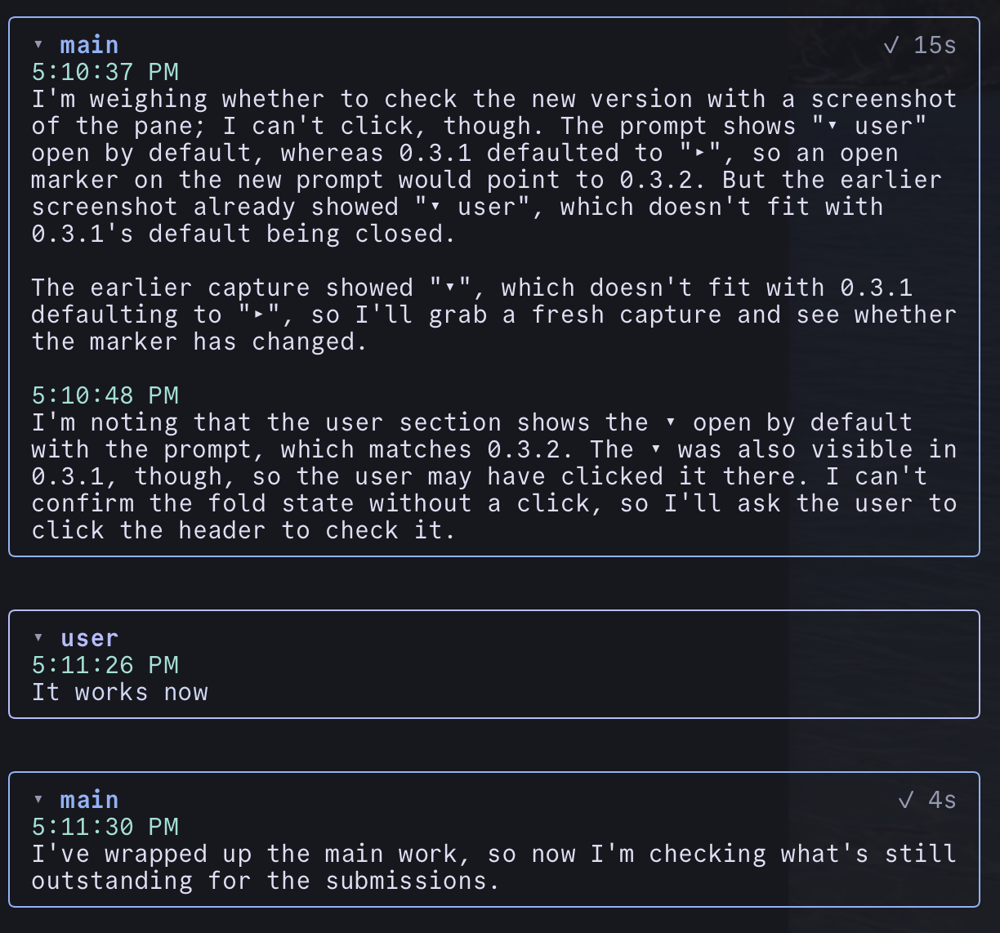

# thinking-pane

Vendored from https://github.com/Sallvainian/claude-code-mods at commit 21b746e (version 0.3.3, MIT). I'm the author.

A pane beside the transcript that shows Claude's thinking as it streams, so you don't have to expand a turn and scroll past the tool calls to find it.



## What it does

- Each turn starts with your prompt in its own box, under a "user" header and the time you sent it. Click the header to fold the box; click a long prompt to see all of it, not just its first three lines.
- The main agent's thinking goes in a card below the prompt, with a timestamp over each thought. Click its header to fold it. File paths are yellow, `code` is pink, and **bold** stays bold.
- Each subagent gets a card under the turn that spawned it, colored by agent type, with a live timer while it runs and its start time under the timer.
- Click a subagent's card to open its page: its own thinking, plus cards for any subagents it spawned. `← back` (or `b` with the pane focused) returns to the card you came from.
- When you open a subagent's transcript in Claude Code, the pane switches to that agent's page. Going back to the main transcript brings back the main view.
- The pane follows the newest thinking. Scroll up to pause that; scroll back to the bottom, or send a new prompt, to resume.
- `/thinking` opens or closes the pane.

The pane docks on the right in the fullscreen layout (`/tui fullscreen`) with a terminal at least 110 columns wide; otherwise it opens above the prompt.

## Access

It reads the thinking chunks of each model step, your prompts, and subagent starts and finishes. It keeps the last 25 turns in the session's plugin state only, and draws the contents of the newest 3; older turns fold to their headers, which open them again. Nothing is written to disk, and it makes no network calls, runs no processes and changes no tool calls.

## Install

```bash
npx claude-code-templates --mod ui/thinking-pane
```

Needs Claude Code 2.1.287 or later; built and tested on 2.1.317 on macOS. Or install it from the upstream marketplace:

```
/plugin install thinking-pane --marketplace Sallvainian/claude-code-mods
```

Tests: `claude plugin test .` runs `tests/pane.test.tsx`.

## License

MIT
